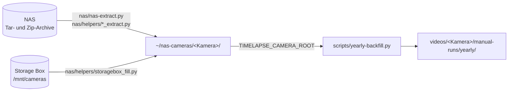

# NAS-Archiv

Werkzeuge, um Bilder aus dem alten Webcam-Archiv auf dem Synology-NAS zu holen und daraus
Kalenderjahr-Videos zu erstellen. Sie liegen im Ordner `nas/` und sind **nicht Teil des
Produktionslaufs**: Cron und Weboberfläche nutzen nichts davon.

Alle Befehle werden im Projektordner ausgeführt. Pfade sind relativ zum Projektordner, `~` ist
das Home-Verzeichnis des Benutzers, unter dem das Projekt läuft.

## Überblick



1. Bilder aus dem Archiv in einen lokalen Ordner pro Kamera holen (`~/nas-cameras/<Kamera>/`).
2. Bei Bedarf Lücken mit Bildern von der Storage Box füllen oder falsche Nachtbilder entfernen.
3. Mit `scripts/yearly-backfill.py` aus diesem Ordner Kalenderjahr-Videos erstellen.

Auf das NAS wird nie geschrieben.

## Voraussetzungen

- **rclone-Remote `nas`** mit Zugriff auf den Webcam-Ordner des NAS. Das NAS ist nur per FTP
  erreichbar (kein Shell- oder Adminzugang). Benötigte Einstellungen des Remotes:
  - FTPS mit `explicit_tls`
  - keine Zertifikatsprüfung (das Zertifikat des NAS enthält keine IP-Adresse)
  - `disable_tls13` (unter TLS 1.3 brachen Übertragungen sporadisch mit
    `426 Data connection` ab)

  Zugangsdaten stehen nur in der lokalen rclone-Konfiguration, nie im Repository.
- **Read-only-Mount `/mnt/nas`**, nur für die Helfer `zip_extract.py` und `seqzip_extract.py`
  (nicht für `nas-extract.py` und die übrigen Helfer):

  ```bash
  rclone mount nas:Webcams /mnt/nas --read-only --daemon
  fusermount -u /mnt/nas   # aushängen
  ```

## Bilder aus den Tar-Archiven holen: `nas/nas-extract.py`

Das Archiv liegt als Tar-Dateien `backup_<Kamera>_<YYYYMMDD>.tar` auf dem NAS.
`nas-extract.py` lädt jedes Tar einmal per `rclone cat` als Datenstrom und schreibt nur die
Bilder im Monthly/Yearly-Zeitfenster nach `~/nas-cameras/<Kamera>/` – flach, nur mit
Dateinamen, ohne die Ordnerkette des Archivs.

```bash
.venv/bin/python3 nas/nas-extract.py --cameras BSV-Steinhude
.venv/bin/python3 nas/nas-extract.py --all-cameras --exclude Kapellenhoehe
```

| Option | Bedeutung |
|---|---|
| `--cameras A B` / `--all-cameras` | welche Kameras geholt werden (eins von beiden ist Pflicht) |
| `--exclude A B` | Kameras auslassen |
| `--limit N` | nach N Tars aufhören (für einen Zeittest) |
| `--output <Ordner>` | Zielordner statt `~/nas-cameras` |
| `--source nas:<Ordner>` | Tars aus einem anderen NAS-Ordner lesen (z. B. sortierte Archive für 2014 bis 2019); Standard `nas:Webcams/storagebox-mirror/tar` |
| `--window-time HH:MM\|sunset` | Mitte des Zeitfensters, Standard aus `config.json` (`interval_window`) |
| `--window-tolerance-minutes N` | Breite des Zeitfensters, Standard aus `config.json` |
| `--until-date YYYY-MM-DD` | keine späteren Bilder übernehmen (Jahre, die die Storage Box bereits abdeckt) |

- **Fortschritt:** `state/nas-extract-done_<Fenster>.txt`, ein Tar pro Zeile und je Zeitfenster
  eine eigene Datei. Ein abgebrochener Lauf setzt dort fort. Für einen reinen Test (z. B. mit
  `--limit 1`) diese Datei danach löschen, sonst überspringt ein späterer echter Lauf das Tar.
- **Log:** `logs/nas-extract.log`.
- **Unbekannte Dateinamen** werden nicht übernommen, sondern als `unknown_format` gezählt.
- **Platzbedarf:** etwa 1/6 der Tar-Größe, weil nur das Zeitfenster übernommen wird
  (Beispiel BSV-Steinhude: 4,7 GiB Tars → 818 MB Bilder).
- **Geschwindigkeit:** ein Tar mit ca. 50 MB dauert rund 2 Sekunden.

## Helfer: `nas/helpers/`

Kleine Werkzeuge für Sonderfälle. Die Quellen (NAS, Storage Box) werden nur gelesen. Was die
Helfer lokal tun, ist verschieden:

- `zip_extract.py`, `seqzip_extract.py` und `storagebox_fill.py` kopieren Bilder nach
  `~/nas-cameras/<Kamera>/`; vorhandene Dateien werden nie überschrieben. Die beiden Zip-Helfer
  lesen über `/mnt/nas`, `storagebox_fill.py` über `/mnt/cameras`.
- `delete_dark.py` **löscht** Bilder in `~/nas-cameras/<Kamera>/`.
- `render_letterbox.py` erstellt ein Video wie `yearly-backfill.py` unter
  `videos/<Kamera>/manual-runs/yearly/`.
- `count_images.py` zählt nur und schreibt CSV-Dateien in einen Ordner außerhalb des Repositorys.

| Helfer | Zweck | Aufruf |
|---|---|---|
| `zip_extract.py` | Bilder aus einem Kamera-Zip 2004–2008 holen (Jahres-Zips und Tars, verschachtelt in einem Zip) | `zip_extract.py <Zip-Name> <Kamera> <erstes Jahr> <letztes Jahr>` |
| `seqzip_extract.py` | dasselbe für Zips ohne zentrales Verzeichnis, die sich nicht normal öffnen lassen | `seqzip_extract.py <Zip-Name> <Kamera> <erstes Jahr> <letztes Jahr>` |
| `storagebox_fill.py` | Fensterbilder eines Jahres von der Storage Box ergänzen (NAS-Bilder haben Vorrang) | `storagebox_fill.py <Kamera> <Jahr>` |
| `delete_dark.py` | dunkle Bilder in Zeiträumen löschen, in denen die Kamerauhr falsch ging | `delete_dark.py <Kamera> <von> <bis> [weitere Zeiträume]` |
| `render_letterbox.py` | Jahresvideo mit wechselnder Auflösung ohne Verzerrung erstellen (alles in 1280x720 eingepasst) | `TIMELAPSE_CAMERA_ROOT=~/nas-cameras render_letterbox.py <Kamera> <Jahr>` |
| `count_images.py` | Bilder einer Kamera auf den NAS-Tars und der Storage Box zählen und vergleichen (pro Jahr, fehlende Tage, Überschneidungen); `tars` lässt sich abbrechen und fortsetzen | `count_images.py tars <Ausgabe> <Bezeichnung> <rclone-Ordner> <Regex>`, `count_images.py box <Ausgabe> <Kamera>`, `count_images.py report <Ausgabe>` |

Aufruf jeweils mit `.venv/bin/python3 nas/helpers/<Helfer>`. Beispiel:

```bash
.venv/bin/python3 nas/helpers/zip_extract.py webcam1_bsv.zip BSV-Steinhude 2004 2008
```

`zip_extract.py` und `seqzip_extract.py` übernehmen alle Dateinamen, deren Datum erkannt wird;
das Zeitfenster wendet erst `yearly-backfill.py` an. Nicht lesbare innere Zips werden gemeldet
und übersprungen.

## Kalenderjahr-Videos aus dem Archiv

`TIMELAPSE_CAMERA_ROOT` ersetzt `/mnt/cameras` als Kamera-Wurzel. Der Ordnername unter
`~/nas-cameras/` ist der Kameraname und damit auch der Ordner unter `videos/`.

```bash
TIMELAPSE_CAMERA_ROOT=~/nas-cameras \
	.venv/bin/python3 scripts/yearly-backfill.py --years 2020 2021 --cameras BSV-Steinhude
```

- Gleiches Zeitfenster wie im Yearly (12:00 ± 90 Min., 5 Bilder pro Tag), aber **ohne**
  Mindestabdeckung: fehlende Tage fehlen einfach im Video und werden als CSV unter
  `reports/yearly-coverage/` gemeldet.
- Ausgabe: wie jedes manuelle Yearly unter
  `videos/<Kamera>/manual-runs/yearly/<Kamera>_<Jahr>-12-31.mp4`. Das Skript wechselt dafür
  selbst in den Projektordner, der Startordner spielt keine Rolle.

## Dateinamen aus dem Archiv

Zusätzlich zu den Formaten der laufenden Kameras erkennt `src/images.py`:

| Kamera | Format | Hinweis |
|---|---|---|
| BSV-Steinhude (alt) | `bsv_steinhude_YYYYMMDDHHMM.jpg` | |
| Cafe-am-Meer-Promenade | `promenade_YYYY_MMDD_HHMMSS_01.jpg` | Uhrzeit ganzjährig Winterzeit (MEZ): im Sommer liegt das 12:00-Fenster bei 13:00 MESZ |

Unbekannte Formate werden nie geraten, sondern übersprungen.

## Lokale Notizen

Projektverlauf, Bestand aller NAS-Ordner und Zahlen zu den erstellten Videos liegen nur lokal
unter `docs/nas-notizen/` (per `.gitignore` nicht im Repository), weil sie Details zur
Infrastruktur enthalten.
