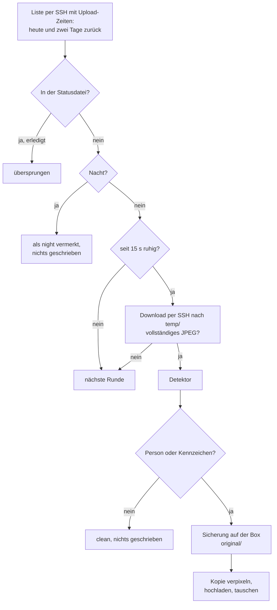

# Verpixelung auf der Storage Box

Verpixelt Personen und Kennzeichen in neuen Kamerabildern **direkt auf der Storage Box**, bevor
die Webseite sie abholt. Das Original wird vorher auf der Box gesichert. Die Videoverpixelung mit `--blur-people`
beschreibt [verpixelung.md](verpixelung.md); Installation, Detektor und die `blur`-Werte gelten
für beide.

**Stand:** in Entwicklung. Erster Testlauf auf der Box am 15.10.2026 im Ordner `BlurTest`
(47 Bilder: 20 verpixelt, 2 ohne Person, 25 Nacht, 0 Fehler, in 8 Runden). Der Cron-Eintrag ist
noch nicht eingerichtet.

Alle Pfade sind relativ zum Projektordner.

## Ablauf

Ein Lauf ist eine Runde; Cron startet jede Minute eine neue. Pro Kamera aus
`privacy.blur_cameras`:



1. **Liste:** Ein einziger `ls -l --time-style=+%s`-Befehl über SSH holt die Bilder von heute,
   gestern und vorgestern **mit ihrer Upload-Zeit** (Sekunden). Er nutzt dieselben Datumsformate
   wie der nächtliche Lauf (`images.date_patterns`). Dauer ca. 0,6–2 Sekunden, unabhängig davon,
   wie groß der Kameraordner ist. Eine Zeile, die sich nicht lesen lässt, bricht die Runde für
   diese Kamera ab, statt ein Bild stillschweigend zu übergehen.
2. **Bereits erledigt:** Bilder mit einem Eintrag in der Statusdatei werden übersprungen, außer
   ihr Eintrag steht noch auf `replacing` (siehe [Stromausfall](#stromausfall-und-nachholen)).
3. **Nacht:** Ein Bild gilt nur als Nachtbild, wenn **sowohl** die Uhrzeit im Dateinamen **als
   auch** die Upload-Zeit auf der Box außerhalb von Sonnenaufgang − Puffer bis Sonnenuntergang +
   Puffer liegen (`daylight_buffer_minutes`, 90 Minuten). Eine falsch gehende Kamerauhr lässt so
   kein Tagbild als Nachtbild durch. Nachtbilder werden nur vermerkt.
4. **Upload fertig:** Laut Liste muss das Bild seit 15 Sekunden unverändert sein. Sonst kommt es
   in der nächsten Runde dran.
5. **Vorprüfung:** Name und Zeitfenster werden geprüft, bevor eine Erkennung dafür läuft. Ein
   Bild, das nie geschrieben werden dürfte, wird gleich als `refused` vermerkt.
6. **Erkennen:** Das Bild wird per SSH (`scp`, nur lesend, über `box_writer.fetch`) nach
   `temp/blur-box/` geladen, **nie über den Mount**: Der kann hängen oder alte Daten liefern.
   Endet die Kopie nicht mit dem JPEG-Endmarker, läuft der Upload noch: nächste Runde. Ist sie
   nach 10 Minuten immer noch unvollständig, gilt der Upload als hängen geblieben und wird jede
   Runde als Fehler geloggt, bis es vollständig ist. Sonst geht sie an den Detektor (Zeitlimit
   120 Sekunden pro Bild, siehe [Zeitlimits](#zeitlimits)). Danach gelten `ignore_boxes` und
   `ignore_top_share` (siehe [verpixelung.md](verpixelung.md#ignore_boxes-und-ignore_top_share)).
7. **Nichts gefunden:** Die Prüfsumme des Bildes auf der Box muss der geprüften Kopie entsprechen
   (die Kamera kann das Bild inzwischen neu geschrieben haben). Dann wird das Bild als `clean`
   vermerkt. **Auf die Box wird nichts geschrieben**, auch keine Sicherung.
8. **Person oder Kennzeichen gefunden:** Erst jetzt wird das Original auf der Box nach `original/` gesichert und
   per SHA-256 geprüft. Die Sicherung muss genau die geprüften Bytes enthalten. Dann wird die
   Kopie verpixelt, unter einem versteckten Namen hochgeladen, geprüft und in einem Schritt
   gegen das Bild getauscht (siehe [Was auf der Box passiert](#was-auf-der-box-passiert)).

Weicht das Bild auf der Box in Schritt 7 oder 8 von der geprüften Kopie ab, bleibt es unverändert
und kommt in der nächsten Runde erneut dran. `original/` enthält so nur Sicherungen verpixelter
Bilder und wird erst angelegt, wenn die erste Person erkannt wird.

Die Bilder werden **einzeln und das neueste zuerst** bearbeitet. Nach einem Ausfall ist so das
Bild, das die Webseite als Nächstes zeigt, zuerst fertig. Ein Fehler betrifft immer nur das
eine Bild; die übrigen werden weiter bearbeitet.

Pro Kamera und Runde beginnt nach 40 Sekunden kein neues Bild mehr (mindestens eines aber
immer). Ein großer Rückstand wird so über mehrere Runden abgearbeitet, und jede Runde fängt
wieder mit dem neuesten Bild an. Neue Uploads warten also nie hinter einem langen Rückstand.

## Aufruf

Testlauf von Hand, nur für die genannte Kamera:

```bash
.venv/bin/python3 -m src.privacy.blur_box --cameras BlurTest
```

Cron (geplant, **noch nicht eingerichtet**):

```cron
* * * * * cd <projektpfad> && .venv/bin/python3 -m src.privacy.blur_box --all-blur-cameras
```

| Option | Bedeutung |
|---|---|
| `--cameras A B` | nur diese Kameras; jede muss in `privacy.blur_cameras` stehen |
| `--all-blur-cameras` | alle Kameras aus `privacy.blur_cameras` (für Cron) |
| `--settle-seconds N` | Wartezeit, bis ein Upload als fertig gilt (Standard 15) |
| `--state-dir PFAD` | Ordner der Statusdateien (Standard `state/privacy/box/`) |

- Ungültige `blur`-Werte, `ignore_boxes` oder `ignore_top_share` brechen den Lauf mit
  `Invalid privacy settings, nothing written: …` ab, bevor die Box kontaktiert wird.

- Eine der beiden Kamera-Optionen ist Pflicht. Ein Lauf darf nur in die Kameras schreiben, mit
  denen er gestartet wurde.
- Steht eine Kamera nicht in `privacy.blur_cameras`, bricht der Lauf ab, bevor die Box
  kontaktiert wird.
- Der Lauf nimmt einen eigenen Lock (`state/privacy-blur.lock`), nicht den Lock des nächtlichen
  Laufs. Läuft noch eine Runde, wird die neue übersprungen.
- Die Verpixelung läuft auch parallel zum nächtlichen Lauf. Gemessen: Die Encodes des
  nächtlichen Laufs belegen höchstens 52–69 % des Arbeitsspeichers, der Detektor braucht ca.
  220 MB (12 %) zusätzlich; das passt. Startet der Pi trotzdem neu, geht nichts verloren
  (Statusdatei vor dem Tausch, geprüfte Sicherung), und die Runde nach dem Neustart holt nach.
  Entschieden am 2026-10-16: keine Pause und keine Speichergrenze.
- Exit-Code 1, wenn ein Bild fehlgeschlagen oder abgelehnt ist, sonst 0.
- Log: `logs/privacy/<Datum>.log`. Pro Kamera und Runde eine Zusammenfassung, z. B.
  `[Scheunenviertel] blurred=1 clean=0 night=0 settling=0 refused=0 failed=0 postponed=0`.
  `postponed` zählt die Bilder, die wegen der 40-Sekunden-Grenze auf die nächste Runde warten.

## Konfiguration

In `config/config.json`:

```json
"ignored_cameras": ["…", "BlurTest"],
"privacy": {
  "blur_cameras": ["BlurTest", "Scheunenviertel"],
  "ignore_boxes": {"Scheunenviertel": [[703, 557, 742, 643]]},
  "ignore_top_share": 0.333,
  "detector_command": ["…"],
  "blur": {"…": "…"}
}
```

- `blur_cameras`: die Kameraordner, in die die Verpixelung schreiben darf. Der
  Konfigurationstest prüft die Namen mit denselben Regeln wie der Schreibcode.
- `BlurTest` ist der Testordner. Er steht auch in `ignored_cameras`, sonst würden der nächtliche
  Lauf und die Weboberfläche ihn als Kamera behandeln. Nach dem Test wird er aus beiden Listen
  entfernt.
- `ignore_boxes`: bekannte Fehlerkennungen pro Kamera, siehe unten. Gilt seit 2026-10-16 auch
  im Video-Modus.
- `ignore_top_share`: Boxen überwiegend im oberen Bilddrittel werden verworfen und unter
  `ignored_boxes` festgehalten, wie in
  [verpixelung.md](verpixelung.md#ignore_boxes-und-ignore_top_share).
- `detector_command` und `blur`: wie in [verpixelung.md](verpixelung.md#konfiguration).

### Bekannte Fehlerkennungen (`ignore_boxes`)

Manche Gegenstände hält der Detektor immer wieder für eine Person, bei Scheunenviertel ein
Wegweiser am Café-Eingang (im Test in allen 20 verpixelten Bildern, in 10 davon als einzige Box).
Für solche Stellen steht pro Kamera eine Referenzbox `[x0, y0, x1, y1]` in Pixeln in der
Konfiguration.

- Eine erkannte Box wird nur übersprungen, wenn sie sich mit der Referenzbox zu mindestens 50 %
  deckt (Schnittfläche geteilt durch Vereinigungsfläche). Eine Person **neben** dem Wegweiser
  deckt sich kaum und wird weiter verpixelt.
- **Bewegt sich die Kamera**, deckt sich der Wegweiser nicht mehr mit der Referenzbox und wird
  wieder verpixelt. Die Ausnahme schaltet sich so selbst ab, statt an eine andere Stelle zu
  wandern. Ein wieder verpixelter Wegweiser ist also ein Zeichen, dass die Box neu bestimmt
  werden muss.
- Bleibt nach dem Überspringen keine Box übrig, gilt das Bild als `clean`; es wird nichts
  geschrieben.
- Jede übersprungene Box steht in der Statusdatei unter `ignored_boxes`.
- Eine Person, die genau an der Stelle des Wegweisers und in seiner Größe steht, wird nicht
  verpixelt. Bei Scheunenviertel ist das hingenommen, weil Personen in dieser Entfernung nicht
  erkennbar sind.

Die Referenzbox ist der Median aller Erkennungen des Gegenstands aus einem Testlauf; 19 von 23
Erkennungen deckten sich damit zu 80–100 %.

## Was auf der Box passiert

Nur `src/privacy/box_writer.py` schreibt auf die Box, und nur über SSH. Auch gelesen wird nur
über SSH (Liste, Download, Prüfsummen). Der Mount `/mnt/cameras` wird vom Box-Job nicht gelesen;
er dient nur dazu, Benutzer und Host der Box zu finden, und bleibt schreibgeschützt (`-o ro`).

Dateien in einem Kameraordner:

| Datei | Bedeutung |
|---|---|
| `<name>.jpg` | das Bild; nach dem Tausch die verpixelte Fassung |
| `original/<name>.<16 Zeichen Prüfsumme>.jpg` | gesichertes Original |
| `original/.<sicherung>.tmp` | Sicherung während des Kopierens |
| `.<name>.jpg.tmp` | hochgeladene verpixelte Fassung vor dem Tausch |

Die versteckten `.tmp`-Dateien enden nicht auf `.jpg`. Weder der nächtliche Lauf noch ein
Programm, das nach `*.jpg` sucht, sieht so eine halb geschriebene Datei. Bleibt nach einem
Abbruch eine `.tmp`-Datei liegen, überschreibt der nächste Versuch sie. Kommt es zu keinem
weiteren Versuch (das Bild ist inzwischen älter als 24 Stunden), bleibt sie liegen: Der Job hat
bewusst kein `rm`. Solche Reste lassen sich von Hand finden (`ls -a <Kamera>/ | grep '\.tmp$'`)
und löschen.

Ein Bild ohne Fund kostet einen Download und einen Befehl (`sha256sum`) und schreibt nichts.
Befehle pro Bild mit Fund:

1. `sha256sum` des Bildes; es muss der geprüften Kopie entsprechen.
2. `cp -T` nach `original/.<sicherung>.tmp`, `sha256sum`, dann `mv -n -T` auf den endgültigen
   Namen. `-n`: Eine vorhandene Sicherung wird nie überschrieben.
3. `scp` der verpixelten Kopie nach `.<name>.jpg.tmp`, dann `sha256sum`.
4. `sha256sum` von Bild, Sicherung und Upload. Nur wenn Bild und Sicherung noch das Original
   sind und der Upload unverändert ist: `mv -T` auf den Bildnamen.
5. `sha256sum` des Bildes: Es muss jetzt die verpixelte Fassung sein.

Der Sicherungsname enthält die Prüfsumme des Inhalts. Derselbe Name steht also immer für
dieselben Bytes. Lädt die Kamera unter demselben Namen etwas anderes hoch, entsteht eine zweite
Sicherung statt einer überschriebenen.

### Zeitlimits

Jeder Zugriff auf die Box hat ein Zeitlimit; ein hängender Befehl wird abgebrochen, das Bild
gilt als fehlgeschlagen und kommt in der nächsten Runde erneut dran.

| Schritt | Limit |
|---|---|
| Liste | wie der Speicherfilter (`LISTING_TIMEOUT_SECONDS`) |
| Befehl per SSH (`sha256sum`, `cp`, `mv`, …) | `COMMAND_TIMEOUT_SECONDS` in `box_writer.py` |
| Download und Upload per `scp` | `UPLOAD_TIMEOUT_SECONDS` in `box_writer.py` |
| Detektor, ein Bild | 120 Sekunden (`DETECTOR_TIMEOUT_SECONDS`) |
| FFprobe/FFmpeg beim Verpixeln | 120 Sekunden |

Früher las der Job über den Mount; hing der, hing die Runde mitsamt Lock, und jede weitere Runde
meldete nur „Skipped". Das ist seit 2026-10-16 ausgeschlossen.

## Sicherheitsregeln

Im Zweifel bleibt das Bild **unverändert**. Der Schreibcode erzwingt:

- **Erlaubte Befehle:** nur `ls -1d`, `sha256sum`, `mkdir`, `cp -T`, `mv -n -T` und `mv -T`,
  dazu `scp` für Upload und Download. Kein `rm`. `cp -T` darf nur auf versteckte `.tmp`-Namen schreiben.
- **Erlaubte Ordner:** nur die Kameras des aktuellen Laufs.
- **Namen:** Kamera- und Bildnamen müssen einem festen Zeichensatz entsprechen (Buchstaben,
  Ziffern, `_`, `-`, Endung `.jpg`), und `images.py` muss Datum und Uhrzeit lesen können. Jeder
  Befehl besteht so aus einfachen Wörtern ohne Sonderzeichen. Alles andere wird abgelehnt,
  bevor die Box kontaktiert wird.
- **Zeitfenster:** nur Bilder, deren Dateiname höchstens 24 Stunden alt ist und höchstens 2
  Stunden in der Zukunft liegt.
- **Mengengrenze:** höchstens 300 Sicherungen pro Kamera und Lauf, etwa doppelt so viele wie
  die Bilder eines ganzen Tages bei SLSV.
- **„Datei fehlt"** gilt nur, wenn die Box das ausdrücklich meldet. Jede andere Antwort bricht
  ab, damit ein Netzwerkfehler nie als „noch keine Sicherung da" gelesen wird.
- Jeder Schreibschritt wird danach per SHA-256 geprüft.

Tests sichern das zusätzlich ab: Nur `box_writer.py` und `storage_filter.py` dürfen `ssh` oder
`scp` starten, `storage_filter.py` darf keine Schreibbefehle enthalten, und die Mount-Unit muss
`-o ro` behalten.

## Statusdatei

Pro Kamera und Monat `state/privacy/box/<Kamera>/<JJJJ-MM>.jsonl` (Monat des Schreibens), eine
Zeile pro Schritt; die letzte Zeile eines Bildes gilt. Eine Runde liest nur die Monate, die ihre
Liste (drei Tage) erreichen kann; ältere Monate bleiben als vollständiges Protokoll liegen. Die
frühere einzelne Datei `state/privacy/box/<Kamera>.jsonl` wird weiterhin mitgelesen, damit kein
Bild doppelt bearbeitet wird.

| Status | Bedeutung | Nächste Runde |
|---|---|---|
| `night` | Nachtbild, nichts geschrieben | übersprungen |
| `clean` | geprüft, keine Person, Bild unverändert | übersprungen |
| `replacing` | Upload fertig, Tausch begonnen | wird geprüft (siehe unten) |
| `blurred` | verpixelt und getauscht | übersprungen |
| `refused` | kann nie geschrieben werden (zu alt, unbekanntes Namensformat); **bleibt unverpixelt** | übersprungen |

Weitere Felder: `detector` und `original_sha256` (Prüfsumme der geprüften Fassung), bei
verpixelten Bildern zusätzlich `backup`, `boxes` (je `[x0, y0, x1, y1, Sicherheit]`, dahinter das
`label` des Detektors, sofern vorhanden) und
`blurred_sha256`, bei übersprungenen Fehlerkennungen `ignored_boxes`, bei `refused` der Grund in
`reason`.

Bilder ohne Eintrag (fehlgeschlagen, Upload noch nicht fertig, auf später verschoben) werden in
der nächsten Runde erneut versucht.

## Stromausfall und Nachholen

- **Ausfall bis zwei Tage:** Die Liste reicht bis vorgestern zurück. Verpasste Tagbilder der
  letzten 24 Stunden werden nachgeholt, das neueste zuerst. Ältere werden als `refused`
  vermerkt und als Fehler geloggt, nie still übergangen.
- **Ausfall über Mitternacht:** Gestern steht in der Liste; die letzten Tagbilder von gestern
  gehen also nicht verloren.
- **Ausfall während der Sicherung:** Es bleibt höchstens `original/.<sicherung>.tmp` liegen, und
  der nächste Versuch überschreibt sie. Unter dem endgültigen Namen steht nie eine halbe Kopie.
- **Ausfall zwischen Tausch und Statuseintrag:** Vor dem Tausch steht `replacing` mit der
  Prüfsumme der verpixelten Fassung in der Statusdatei. Die nächste Runde vergleicht sie mit
  dem Bild auf der Box. Stimmt sie, wird `blurred` nachgetragen, sonst wird das Bild neu
  bearbeitet.
- **Abgerissene Zeile in der Statusdatei:** Der nächste Eintrag beginnt in einer neuen Zeile;
  die beschädigte Zeile gilt als fehlender Eintrag.

## Leistung

Gemessen auf dem Raspberry Pi 4 (2 GB):

| Schritt | Dauer |
|---|---|
| Liste per SSH (SLSV, 2 Tage, ca. 200 Bilder) | ca. 1,9 Sekunden (über den Mount: 6,1 Sekunden) |
| Liste per SSH (Scheunenviertel) | ca. 0,6 Sekunden |
| Download per SSH | ca. 0,5–1 Sekunde pro Bild (geschätzt, eine eigene SSH-Verbindung) |
| Erkennung | ca. 7,5–10 Sekunden pro Bild, plus ca. 1 Sekunde Detektorstart |
| Verpixeln | ca. 1 Sekunde pro Bild mit Personen |

Zeit vom Upload bis zum verpixelten Bild: bis zu 60 Sekunden bis zur nächsten Runde, 15
Sekunden Wartezeit für den Upload, dann ca. 10–15 Sekunden Bearbeitung. Nach einem Ausfall
schafft eine Runde pro Kamera etwa 4 Bilder (40-Sekunden-Grenze); ein Rückstand von 12 Bildern
(2 Stunden Ausfall bei SLSV) ist also nach etwa 3–4 Minuten abgearbeitet.

## Grenzen

- **Die Webseite kann ein Original abholen**, wenn ihr Cron zwischen Kamera-Upload und Tausch
  läuft. Das lässt sich nur auf dem Webserver ausschließen, z. B. indem er nur Bilder nimmt, die
  mindestens 3 Minuten alt sind.
- Zwischen der letzten Prüfung und dem Tausch liegen zwei getrennte Befehle (Millisekunden).
  Schreibt die Kamera genau dann unter demselben Namen neu, wird diese neue Fassung ohne
  Sicherung überschrieben. Bewusst hingenommen: Bei Dateinamen mit Uhrzeit kommt das praktisch
  nicht vor.
- Liegengebliebene `.tmp`-Dateien räumt der Job nicht weg (kein `rm`), siehe
  [Was auf der Box passiert](#was-auf-der-box-passiert).
- Bilder, die älter als 24 Stunden sind, verpixelt die Runde nicht mehr; sie stehen als
  `refused` im Log.
- Keine Erkennung findet 100 % aller Personen (siehe [verpixelung.md](verpixelung.md#grenzen)).

## Fehlersuche

| Meldung im Log | Ursache | Folge / Lösung |
|---|---|---|
| `Not in privacy.blur_cameras, nothing written: …` | Kamera fehlt in `blur_cameras` | Kamera eintragen oder Aufruf prüfen |
| `Invalid privacy settings, nothing written: …` | ungültiger Wert in `blur`, `ignore_boxes` oder `ignore_top_share` | Wert laut [verpixelung.md](verpixelung.md#konfiguration) korrigieren |
| `No storage box: No SSHFS mount found …` | Kamera-Mount nicht aktiv; aus ihm liest der Job Benutzer und Host der Box | `cameras-sshfs.service` prüfen |
| `Camera folder not found on the storage box` | Ordner fehlt auf der Box | Name in `blur_cameras` prüfen |
| `Skipped: Another timelapse run holds the lock: …privacy-blur.lock` | vorige Runde läuft noch | nichts; die nächste Runde holt nach |
| `Refused, stays unblurred: …` | Bild zu alt oder Namensformat unbekannt | **Bild bleibt unverpixelt**; bei Bedarf von Hand bearbeiten |
| `Deferred …: … lies in the future` | Uhrzeit im Dateinamen mehr als 2 h voraus | Kamerauhr prüfen; wird jede Runde neu versucht |
| `Deferred …: Limit of 300 backups per run reached` | sehr großer Rückstand | nichts; die nächste Runde macht weiter |
| `Not processed, retrying next round: …` | Fehler bei diesem Bild (Detektor, SSH, Prüfsumme) | Meldung dahinter lesen; wird jede Runde neu versucht |
| `… has been incomplete for over 10 minutes.` | Upload der Kamera hängt | Kamera bzw. FTP-Upload prüfen; **Bild bleibt bis dahin unverpixelt** |
| `Cannot write to the storage box: …` | ungültiger Kameraname oder ungültige Zeitzone in der Konfiguration | `config.json` prüfen |
| `… changed while it was being backed up` | Kamera schreibt das Bild noch | nichts |
| `… on the box differs from the checked copy; retrying.` | Die Kamera hat das Bild während der Erkennung neu geschrieben | nichts; nächste Runde prüft erneut |
| `Download of … failed on the storage box` | Bild zwischen Liste und Download verschwunden, oder SSH-Fehler | nichts; nächste Runde versucht es erneut |
| `Download of … timed out on the storage box` | Netzwerk hängt | Verbindung prüfen; das Bild kommt in der nächsten Runde dran |
| `Detector timed out after 120 s …` | Rechner überlastet (z. B. parallel zum nächtlichen Lauf) | Arbeitsspeicher prüfen; nächste Runde versucht es erneut |
| `Cannot read the size of …` | Bild beschädigt, FFprobe liefert keine Größe | betrifft nur dieses Bild; Bild auf der Box prüfen |
| `Blurred copy of … not uploaded: …` | Verpixeln hat das Bild nicht verändert oder kein vollständiges JPEG erzeugt | wird jede Runde neu versucht; Meldung dahinter lesen |
| `No blurrable region left for …` | Detektor meldet eine Box außerhalb des Bildes | Detektor bzw. Modell prüfen |
| `SSH to the storage box failed: …` | Netzwerk oder SSH-Schlüssel | Verbindung prüfen |
| `Could not tell whether … exists` | unklare Antwort der Box | Meldung dahinter lesen; es wird nichts geschrieben |
| `Storage box listing failed for camera …` | `ls` auf der Box fehlgeschlagen | Rechte und Ordner auf der Box prüfen |
| `Unreadable storage box listing line for camera …` | unerwartete Ausgabe von `ls -l` | Meldung prüfen; die Runde dieser Kamera bricht ab, statt ein Bild zu übergehen |
| `Round aborted, nothing replaced after this: …` | Fehler beim Auflisten der Kamera | Meldung dahinter lesen |

## Entfernt am 2026-10-16

Der frühere lokale Testmodus (`src/privacy/inplace.py`, `scripts/blur-test-camera.py`) ist
entfernt; seine Hilfsfunktionen stecken jetzt in `blur_box.py`. Eine Sicherung liegt in
`video-backup/removed-2026-10-16/` (nicht im Repository).
