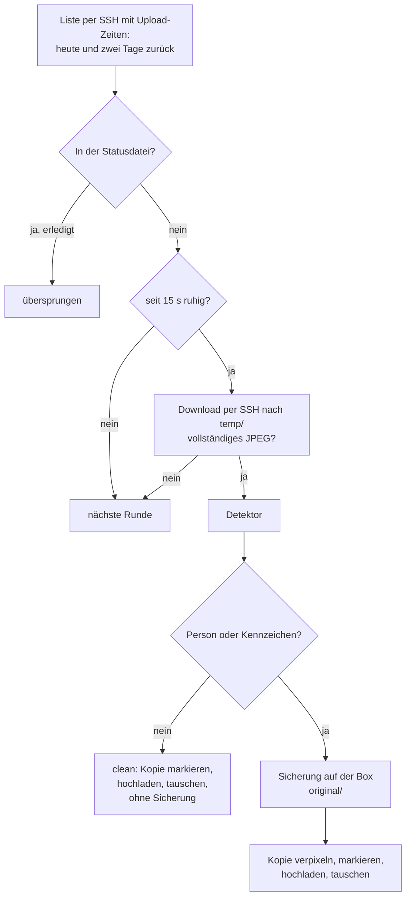

# Verpixelung auf der Storage Box

Verpixelt Personen und Kennzeichen in neuen Kamerabildern **direkt auf der Storage Box**, bevor
die Webseite sie abholt. Bei einem Fund wird das Original vorher auf der Box gesichert; Bilder
ohne Fund bekommen nur die Markierung. Installation, Detektor,
die `blur`-Werte und die Regeln für verworfene Boxen beschreibt [verpixelung.md](verpixelung.md).

**Stand:** Erster Testlauf auf der Box am 15.10.2026 im Ordner `BlurTest` (47 Bilder: 20
verpixelt, 2 ohne Person, 25 Nacht, 0 Fehler, in 8 Runden). Seit dem 23.10.2026 verpixelt Cron
jede Nacht vor dem Zeitraffer-Lauf die offenen Bilder der letzten 48 Stunden (`--catch-up`,
erster Lauf von Hand: Scheunenviertel 83 verpixelt / 19 ohne Person, SLSV 2 / 149, 0 Fehler).
Seit dem 16.11.2026 (12:45) startet Cron die Runde und den [Wächter](#wächter) alle 5 Minuten,
jedes geprüfte Bild bekommt die [Markierung für die Webseite](#markierung-für-die-webseite),
und es gibt keine Nachtregel mehr. Der Abholjob der Website veröffentlicht von Blur-Kameras nur
markierte Bilder; seine Kameraliste muss zu unserer passen (siehe [Konfiguration](#konfiguration)).

Seit dem 05.11.2026 verpixelt außerdem jedes von Hand gestartete Daily-, Weekly-, Monthly- und
Yearly-Video einer Blur-Kamera die Bilder, die es braucht, vorher auf der Box (Standard, kein
Schalter): [Verpixelung bei von Hand gestarteten Videos](#verpixelung-bei-von-hand-gestarteten-videos).

Alle Pfade sind relativ zum Projektordner.

## Ablauf

Ein Lauf ist eine Runde; Cron startet alle 5 Minuten eine neue. Pro Kamera aus
`privacy.blur_cameras`:



1. **Liste:** Ein einziger `ls -l --time-style=+%s`-Befehl über SSH holt die Bilder von heute,
   gestern und vorgestern **mit ihrer Upload-Zeit** (Sekunden). Er nutzt dieselben Datumsformate
   wie der nächtliche Lauf (`images.date_patterns`). Dauer ca. 0,6–2 Sekunden, unabhängig davon,
   wie groß der Kameraordner ist. Eine Zeile, die sich nicht lesen lässt, bricht die Runde für
   diese Kamera ab, statt ein Bild stillschweigend zu übergehen.
2. **Bereits erledigt:** Bilder mit einem Eintrag in der Statusdatei werden übersprungen, außer
   ihr Eintrag steht noch auf `replacing` (siehe [Stromausfall](#stromausfall-und-nachholen)).
3. **Tag und Nacht:** Seit dem 16.11.2026 gibt es keine Nachtregel mehr; der Detektor prüft jedes
   Bild, auch nachts. Ältere Einträge mit `night` gelten weiter als erledigt.
4. **Upload fertig:** Laut Liste muss das Bild seit 15 Sekunden unverändert sein. Sonst kommt es
   in der nächsten Runde dran.
5. **Vorprüfung:** Name und Zeitfenster werden geprüft, bevor eine Erkennung dafür läuft. Ein
   Bild, das nie geschrieben werden dürfte, wird gleich als `refused` vermerkt.
6. **Erkennen:** Das Bild wird per SSH (`scp`, nur lesend, über `box_writer.fetch`) nach
   `temp/blur-box/` geladen; einen Mount gibt es nicht mehr (er konnte hängen oder alte Daten liefern).
   Endet die Kopie nicht mit dem JPEG-Endmarker, läuft der Upload noch: nächste Runde. Ist sie
   nach 10 Minuten immer noch unvollständig, gilt der Upload als hängen geblieben und wird jede
   Runde als Fehler geloggt, bis es vollständig ist. Sonst geht sie an den Detektor (Zeitlimit
   120 Sekunden pro Bild, siehe [Zeitlimits](#zeitlimits)). Danach gelten `ignore_boxes`,
   `ignore_top_share` (auch je Kamera), `skip_labels` und `min_person_score` (siehe
   [verpixelung.md](verpixelung.md#ignore_boxes-ignore_top_share-skip_labels-und-min_person_score)).
7. **Nichts gefunden:** Die Kopie bekommt die [Markierung](#markierung-für-die-webseite) und wird
   **ohne Sicherung** getauscht. Vorher prüft der Schreibcode, dass die Kopie ohne Markierung genau
   die geprüften Bytes sind und das Bild auf der Box noch das geprüfte ist (die Kamera kann es
   inzwischen neu geschrieben haben). Dann wird das Bild als `clean` vermerkt.
8. **Person oder Kennzeichen gefunden:** Erst jetzt wird das Original auf der Box nach `original/` gesichert und
   per SHA-256 geprüft. Die Sicherung muss genau die geprüften Bytes enthalten. Dann wird die
   Kopie verpixelt, markiert, unter einem versteckten Namen hochgeladen, geprüft und in einem Schritt
   gegen das Bild getauscht (siehe [Was auf der Box passiert](#was-auf-der-box-passiert)).

Weicht das Bild auf der Box in Schritt 7 oder 8 von der geprüften Kopie ab, bleibt es unverändert
und kommt in der nächsten Runde erneut dran. `original/` enthält so nur Sicherungen verpixelter
Bilder und wird erst angelegt, wenn die erste Person erkannt wird.

Die Bilder werden **einzeln und das neueste zuerst** bearbeitet. Nach einem Ausfall ist so das
Bild, das die Webseite als Nächstes zeigt, zuerst fertig. Ein Fehler betrifft immer nur das
eine Bild; die übrigen werden weiter bearbeitet.

Pro Kamera und Runde beginnt nach 40 Sekunden kein neues Bild mehr (mindestens eines aber
immer). Ein großer Rückstand wird so über mehrere Runden abgearbeitet, und jede Runde fängt
wieder mit dem neuesten Bild an. Neue Uploads warten also nie hinter einem langen Rückstand.

## Aufruf

Lauf von Hand, nur für die genannte Kamera:

```bash
.venv/bin/python3 -m src.privacy.blur_box --cameras <Kamera>
```

Cron für die laufende Runde und den [Wächter](#wächter) (eingerichtet am 16.11.2026): beide alle
5 Minuten, rund um die Uhr. Alle 5 Minuten reichen, weil die Website
ihre Bilder ebenfalls alle 5 Minuten abholt und ihr Bild nur alle 15 Minuten erneuert. Die Grenze
von 4 Minuten (`timeout -k 10 240`) beendet eine hängende Runde, bevor die nächste startet; sonst
fände die nächste den Lock noch belegt und fiele aus.

```cron
*/5 * * * * cd <projektpfad> && export TIMELAPSE_STORAGE_BOX=<ssh-alias> && timeout -k 10 240 .venv/bin/python3 -m src.privacy.blur_box --all-blur-cameras
*/5 * * * * cd <projektpfad> && export TIMELAPSE_STORAGE_BOX=<ssh-alias> && timeout 60 .venv/bin/python3 -m src.privacy.blur_watch
```

`./install.sh cron_hint` druckt beide Zeilen mit dem echten Projektpfad und Alias.

Dazu kommt das nächtliche Nachholen (`--catch-up`, Cron-Zeile in
[betrieb.md](betrieb.md#nächtlicher-produktionslauf)): Es prüft um 02:00 die Bilder der letzten
48 Stunden, die die Runden nicht geschafft haben, z. B. nach einem Ausfall. Die 45 Minuten gelten
je Kamera, bei zwei Kameras dauert es also bis etwa 90 Minuten. Startet um 02:00 gleichzeitig eine
Runde und bekommt sie die Sperre zuerst, fällt das Nachholen in dieser Nacht aus (`Skipped`); die
Runden arbeiten den Rest ab.

| Option | Bedeutung |
|---|---|
| `--cameras A B` | nur diese Kameras; jede muss in `privacy.blur_cameras` stehen |
| `--all-blur-cameras` | alle Kameras aus `privacy.blur_cameras` (für Cron) |
| `--catch-up` | 45 Minuten pro Kamera statt 40 Sekunden: die offenen Bilder der Liste (bis 48 Stunden alt) in einem Lauf; läuft nachts vor dem Zeitraffer-Lauf. Die Grenze gibt den Lock auch bei hängender Box rechtzeitig für die Videos frei |
| `--settle-seconds N` | Wartezeit, bis ein Upload als fertig gilt (Standard 15) |
| `--state-dir PFAD` | Ordner der Statusdateien (Standard `state/privacy/box/`) |

- Ungültige `blur`-Werte, `ignore_boxes`, `ignore_top_share` (auch je Kamera), `skip_labels` oder `min_person_score` brechen den Lauf mit
  `Invalid privacy settings, nothing written: …` ab, bevor die Box kontaktiert wird.

- Eine der beiden Kamera-Optionen ist Pflicht. Ein Lauf darf nur in die Kameras schreiben, mit
  denen er gestartet wurde.
- Steht eine Kamera nicht in `privacy.blur_cameras`, bricht der Lauf ab, bevor die Box
  kontaktiert wird.
- Der Lauf nimmt einen eigenen Lock (`state/privacy-blur.lock`), nicht den Lock des nächtlichen
  Laufs. Denselben Lock halten die Runde, das Nachholen und die Verpixelung eines von Hand
  gestarteten Videos. Ist er belegt, wird der neue Lauf übersprungen (`Skipped`, Exit-Code 0).
- Die Verpixelung läuft auch parallel zum nächtlichen Lauf. Gemessen: Die Encodes des
  nächtlichen Laufs belegen höchstens 52–69 % des Arbeitsspeichers, der Detektor braucht ca.
  220 MB (12 %) zusätzlich; das passt (Messung auf dem früheren Pi mit 2 GB, der VPS hat 3,8 GB).
  Startet der Rechner trotzdem neu, geht nichts verloren
  (Statusdatei vor dem Tausch, geprüfte Sicherung), und die Runde nach dem Neustart holt nach.
  Entschieden am 2026-10-16: keine Pause und keine Speichergrenze.
- Exit-Code 1, wenn ein Bild fehlgeschlagen oder abgelehnt ist, und wenn der Lauf vor dem ersten
  Bild abbricht: `privacy.detector_command` fehlt, eine Kamera steht nicht in
  `privacy.blur_cameras`, die Einstellungen sind ungültig, `TIMELAPSE_STORAGE_BOX` fehlt
  (`No storage box`), die Box ist nicht beschreibbar (`Cannot write to the storage box`), ein
  Kameraordner fehlt (`Camera folder not found`) oder die Runde bricht ab (`Round aborted`). Sonst 0, auch wenn die Runde
  übersprungen wurde, weil noch eine andere läuft.
- Log: `logs/privacy/<Datum>.log`. Pro Kamera und Runde eine Zusammenfassung, z. B.
  `[Scheunenviertel] blurred=1 clean=0 settling=0 refused=0 failed=0 postponed=0`.
  `postponed` zählt die Bilder, die wegen der 40-Sekunden-Grenze auf die nächste Runde warten.

## Markierung für die Webseite

Jedes geprüfte Bild trägt seit dem 16.11.2026 eine Markierung: einen JPEG-Kommentar mit dem Text
`blur:checked=true`, direkt hinter den ersten zwei Bytes der Datei (`FF D8`). Es sind immer genau
diese 21 Bytes: `FF FE 00 13`, dann `blur:checked=true`. Der Abholjob der Webseite veröffentlicht
von Blur-Kameras nur Bilder mit dieser Markierung. Ein Bild, das der Detektor noch nicht geprüft
hat, trägt keine und wird nicht veröffentlicht; die Webseite zeigt dann weiter das letzte geprüfte
Bild.

- **Verpixelte Bilder** bekommen sie vor dem Hochladen. Die Sicherung in `original/` bleibt ohne.
- **Bilder ohne Person** bekommen sie auch, **ohne Sicherung**: Die Pixel ändern sich nicht, und
  ohne die 21 Bytes ist die Datei wieder genau das Original. Das prüft der Schreibcode vor dem
  Tausch.
- Die Markierung ändert kein Pixel. FFmpeg, die Zeitraffer und die Vorschau zeigen dasselbe Bild.
- Die Runde und das Nachholen markieren jedes geprüfte Bild: sie liefern die neuen Bilder der
  Webseite. Ein [von Hand gestartetes Video](#verpixelung-bei-von-hand-gestarteten-videos)
  markiert nur Bilder aus den Tagen, die auch die Runde nimmt (heute und die zwei Tage davor). Diese
  Bilder gelten danach als erledigt, und die Runde kommt nicht mehr zu ihnen; ohne die Markierung
  erschienen sie nie auf der Webseite. Ältere Bilder verpixelt es ohne Markierung und lässt Bilder
  ohne Person unberührt.
- Bilder von vor dem 16.11.2026 und Bilder von Kameras ohne Verpixelung tragen keine Markierung.
  Optional markiert [`extras/mark_newest.py`](../extras/README.md) bei allen übrigen Kameras das
  neueste Bild ungeprüft (nicht angeschlossen; anschließen per Cron-Zeile, siehe dort).
- Code: `src/privacy/checked_mark.py`. Von Hand prüfen, an einer lokalen Kopie (z. B. vorher
  `scp <ssh-alias>:<Kamera>/<bild>.jpg .`) oder am öffentlichen Bild der Webseite:
  `head -c 32 <bild>.jpg | grep -a 'blur:checked=true'`.

## Wächter

`src/privacy/blur_watch.py` meldet Bilder, die zu lange ungeprüft auf der Box liegen. Er fragt pro
Kamera aus `privacy.blur_cameras` die Bildliste der letzten drei Tage ab (ein `ls`, kein Bild wird
geladen) und vergleicht sie mit der Statusdatei. Ein Bild ist **liegen geblieben**, wenn es seit
mehr als **10 Minuten** auf der Box liegt und weder `blurred` noch `clean` noch `night` ist (also
ohne Eintrag, `refused` oder `replacing`). Eine Nachtausnahme gibt es nicht: der Detektor läuft
rund um die Uhr.

```bash
.venv/bin/python3 -m src.privacy.blur_watch
```

- **Nur lesend:** kein Schreiben auf die Box, keine Statuszeile, kein Detektor, kein Lock. Er
  meldet also auch dann, wenn eine Runde hängt oder der Detektor ausfällt.
- **Log** (`logs/privacy/<Datum>.log`, neben den Runden): pro Kamera mit liegen gebliebenen
  Bildern eine Warnung mit höchstens 10 Namen, z. B.
  `[SLSV] 2 images unblurred for more than 10 minutes: …`, und bei jedem Lauf eine Abschlusszeile
  `Stale check: 2 cameras, nothing stale` (bzw. `…, 2 stale images`). Fehlt diese Zeile, läuft der
  Wächter selbst nicht.
- Die Warnung wiederholt sich bei jedem Lauf, bis das Bild geprüft ist (Runde, Nachholen oder ein
  von Hand gestartetes Video) oder aus den drei Tagen der Liste fällt.
- **Exit-Code** 0, auch mit Warnungen; 1 nur, wenn die Box nicht erreichbar ist oder eine Liste
  fehlschlägt (die anderen Kameras werden trotzdem geprüft).
- Eine Push-Nachricht gibt es nicht; die Warnung steht nur im Log.

## Konfiguration

In `config/config.json` (die Weboberfläche legt ihre Änderungen daran in `config/settings-privacy.json`
darüber, siehe unten):

```json
"ignored_cameras": ["…"],
"privacy": {
  "blur_cameras": ["Scheunenviertel", "SLSV"],
  "ignore_boxes": {"Scheunenviertel": [[703, 557, 742, 643]]},
  "ignore_top_share": 0.333,
  "detector_command": ["…"],
  "blur": {"…": "…"}
}
```

- `blur_cameras`: die Kameraordner, in die die Verpixelung schreiben darf. Der
  Konfigurationstest prüft die Namen mit denselben Regeln wie der Schreibcode.
- **Der Abholjob der Website hat eine eigene Liste** (`webcam_list.config`, auf dem Server des
  Abholskripts, nicht in diesem Repository). Sie muss dieselben Kameras enthalten wie
  `blur_cameras`; wer die eine ändert, ändert die andere mit. Reihenfolge und Folgen:
  [Handbuch](handbuch.md#blur-kamera-hinzufügen-oder-entfernen).
- `ignore_boxes`: bekannte Fehlerkennungen pro Kamera, siehe unten.
- `ignore_top_share`: Boxen überwiegend im oberen Bilddrittel werden verworfen und unter
  `ignored_boxes` festgehalten, wie in
  [verpixelung.md](verpixelung.md#ignore_boxes-ignore_top_share-skip_labels-und-min_person_score).
  `ignore_top_share_per_camera` ersetzt den Wert für eine Kamera.
- `skip_labels`: pro Kamera `vehicle`/`plate`, die nie verpixelt werden (nicht im Beispiel oben;
  heute nur SLSV), siehe ebenda.
- `min_person_score`: pro Kamera Mindestsicherheit für Personen (heute nur SLSV, `0.35`), siehe
  ebenda.
- `detector_command` und `blur`: wie in [verpixelung.md](verpixelung.md#konfiguration).

**Änderungen auf der Weboberfläche.** Im Reiter „Verpixelung“ ([weboberflaeche.md](weboberflaeche.md#reiter-verpixelung-verpixelungphp))
lassen sich `blur_cameras`, die drei `blur`-Werte, `min_person_score`, `ignore_boxes` und
`ignore_top_share_per_camera` ändern; sie stehen dann in `config/settings-privacy.json`, und
`load_config()` legt sie über `config.json`. Der nächste Lauf liest sie, der Nachtlauf ebenso wie ein von Hand gestartetes Video.
Für die Box-Verpixelung heißt das:

- Eine **neu angehakte** Kamera wird ab der nächsten Runde (alle 5 Minuten) verpixelt, einschließlich
  der Bilder von heute und den zwei Tagen davor (die Runden arbeiten den Rückstand nach und nach ab,
  den Rest holt das Nachholen um 02:00). Ihre ersten automatischen Videos nutzen nur bestätigte Bilder
  ([Sperre](#sperre-in-automatischen-videos)) und können deshalb übersprungen oder kurz sein. Sie
  nutzt die Schwellen des Detektors für alle Kameras; ihre Qualität ist erst nach einem Blick auf
  die ersten Ergebnisse geprüft.
- **Beide Fälle gehören auch in `webcam_list.config` des Abholjobs**, in der Reihenfolge aus dem
  [Handbuch](handbuch.md#blur-kamera-hinzufügen-oder-entfernen).
- Eine **abgewählte** Kamera wird nicht mehr verpixelt. Bei einer Kamera, die schon läuft, zeigt der
  Reiter „Wichtig!“ und einen eigenen Block im Bestätigungsdialog: Ihre neuen Bilder blieben
  unverpixelt, und die Videos zeigen Menschen wieder erkennbar.
- Neue `blur`-Werte, Schwellen, Streifen und Rahmen wirken nur auf Bilder, die danach verpixelt werden;
  bereits verpixelte Bilder bleiben, wie sie sind.

### Bekannte Fehlerkennungen (`ignore_boxes`)

Manche Gegenstände hält der Detektor immer wieder für eine Person, bei Scheunenviertel ein
Wegweiser am Café-Eingang (im Test in allen 20 verpixelten Bildern, in 10 davon als einzige Box).
Für solche Stellen steht pro Kamera eine Referenzbox `[x0, y0, x1, y1]` in Pixeln in der
Konfiguration.

- Eine erkannte Box wird nur übersprungen, wenn sie sich mit der Referenzbox zu mindestens 50 %
  deckt (Schnittfläche geteilt durch Vereinigungsfläche). Eine Person **neben** dem Wegweiser
  deckt sich kaum und wird weiter verpixelt.
- **Bewegt sich die Kamera**, deckt sich der Wegweiser nicht mehr mit der Referenzbox und wird
  wieder verpixelt. Die Ausnahme schaltet sich so selbst ab, statt an eine andere Stelle zu
  wandern. Ein wieder verpixelter Wegweiser ist also ein Zeichen, dass die Box neu bestimmt
  werden muss.
- Bleibt nach dem Überspringen keine Box übrig, gilt das Bild als `clean`; es wird nichts
  geschrieben.
- Jede übersprungene Box steht in der Statusdatei unter `ignored_boxes`.
- Eine Person, die genau an der Stelle des Wegweisers und in seiner Größe steht, wird nicht
  verpixelt. Bei Scheunenviertel ist das hingenommen, weil Personen in dieser Entfernung nicht
  erkennbar sind.

Die Referenzbox ist der Median aller Erkennungen des Gegenstands aus einem Testlauf; 19 von 23
Erkennungen deckten sich damit zu 80–100 %.

## Was auf der Box passiert

Nur `src/privacy/box_writer.py` schreibt auf die Box, und nur über SSH. Auch gelesen wird nur
über SSH (Liste, Download, Prüfsummen). Einen eingebundenen Ordner gibt es nicht; die Box nennt
`TIMELAPSE_STORAGE_BOX` (ein Alias aus `~/.ssh/config`).

Dateien in einem Kameraordner:

| Datei | Bedeutung |
|---|---|
| `<name>.jpg` | das Bild; nach dem Tausch die verpixelte bzw. markierte Fassung |
| `original/<name>.<16 Zeichen Prüfsumme>.jpg` | gesichertes Original |
| `original/.<sicherung>.tmp` | Sicherung während des Kopierens |
| `.<name>.jpg.tmp` | hochgeladene verpixelte bzw. markierte Fassung vor dem Tausch |

Die versteckten `.tmp`-Dateien enden nicht auf `.jpg`. Weder der nächtliche Lauf noch ein
Programm, das nach `*.jpg` sucht, sieht so eine halb geschriebene Datei. Bleibt nach einem
Abbruch eine `.tmp`-Datei liegen, überschreibt der nächste Versuch sie. Kommt es zu keinem
weiteren Versuch (das Bild ist inzwischen älter als 48 Stunden), bleibt sie liegen: Der Job hat
bewusst kein `rm`. Solche Reste lassen sich von Hand finden
(`ssh <ssh-alias> ls -a <Kamera> <Kamera>/original | grep '\.tmp$'`, mit dem Basisordner davor,
falls `TIMELAPSE_STORAGE_BOX` einen nennt) und löschen.

Befehle pro Bild ohne Fund (keine Sicherung):

1. `scp` der markierten Kopie nach `.<name>.jpg.tmp`.
2. `sha256sum` von Bild und Upload. Nur wenn das Bild noch das geprüfte ist und der Upload
   unverändert ist: `mv -T` auf den Bildnamen.
3. `sha256sum` des Bildes: Es muss jetzt die markierte Fassung sein.

Befehle pro Bild mit Fund:

1. `sha256sum` des Bildes; es muss der geprüften Kopie entsprechen.
2. `cp -T` nach `original/.<sicherung>.tmp`, `sha256sum`, dann `mv -n -T` auf den endgültigen
   Namen. `-n`: Eine vorhandene Sicherung wird nie überschrieben.
3. `scp` der verpixelten, markierten Kopie nach `.<name>.jpg.tmp`, dann `sha256sum`.
4. `sha256sum` von Bild, Sicherung und Upload. Nur wenn Bild und Sicherung noch das Original
   sind und der Upload unverändert ist: `mv -T` auf den Bildnamen.
5. `sha256sum` des Bildes: Es muss jetzt die verpixelte Fassung sein.

Der Sicherungsname enthält die Prüfsumme des Inhalts. Derselbe Name steht also immer für
dieselben Bytes. Lädt die Kamera unter demselben Namen etwas anderes hoch, entsteht eine zweite
Sicherung statt einer überschriebenen.

### Zeitlimits

Jeder Zugriff auf die Box hat ein Zeitlimit; ein hängender Befehl wird abgebrochen, das Bild
gilt als fehlgeschlagen und kommt in der nächsten Runde erneut dran.

| Schritt | Limit |
|---|---|
| Liste | wie der Speicherfilter (`LISTING_TIMEOUT_SECONDS`) |
| Befehl per SSH (`sha256sum`, `cp`, `mv`, …) | `COMMAND_TIMEOUT_SECONDS` in `box_writer.py` |
| Download und Upload per `scp` | `UPLOAD_TIMEOUT_SECONDS` in `box_writer.py` |
| Detektor, ein Bild | 120 Sekunden (`DETECTOR_TIMEOUT_SECONDS`) |
| FFprobe/FFmpeg beim Verpixeln | 120 Sekunden |

Früher las der Job über den Mount; hing der, hing die Runde mitsamt Lock, und jede weitere Runde
meldete nur „Skipped". Das ist seit 2026-10-16 ausgeschlossen.

## Sicherheitsregeln

Im Zweifel bleibt das Bild **unverändert**. Der Schreibcode erzwingt:

- **Erlaubte Befehle:** nur `ls -1d`, `ls -1` (Inhalt von `original/`), `sha256sum`, `mkdir`, `cp -T`, `mv -n -T` und `mv -T`,
  dazu `scp` für Upload und Download. Kein `rm`. `cp -T` darf nur auf versteckte `.tmp`-Namen schreiben.
- **Erlaubte Ordner:** nur die Kameras des aktuellen Laufs.
- **Namen:** Kamera- und Bildnamen müssen einem festen Zeichensatz entsprechen (Buchstaben,
  Ziffern, `_`, `-`, Endung `.jpg`), und `images.py` muss Datum und Uhrzeit lesen können. Jeder
  Befehl besteht so aus einfachen Wörtern ohne Sonderzeichen. Alles andere wird abgelehnt,
  bevor die Box kontaktiert wird.
- **Zeitfenster:** nur Bilder, deren Dateiname höchstens 48 Stunden alt ist und höchstens 2
  Stunden in der Zukunft liegt.
- **Mengengrenze:** höchstens 300 Sicherungen pro Kamera und Lauf, etwa doppelt so viele wie
  die Bilder eines ganzen Tages bei SLSV.
- **„Datei fehlt"** gilt nur, wenn die Box das ausdrücklich meldet. Jede andere Antwort bricht
  ab, damit ein Netzwerkfehler nie als „noch keine Sicherung da" gelesen wird.
- Jeder Schreibschritt wird danach per SHA-256 geprüft.

Tests sichern das zusätzlich ab: Nur `box_writer.py`, `storage_box.py` (hält den ssh-Aufruf) und
`frame_source.py` dürfen `ssh`, `scp` oder `rsync` starten. `storage_box.py` und `storage_filter.py`
(das die Befehle baut) dürfen keine Schreibbefehle enthalten, und `frame_source.py` holt per `rsync`
nur von der Box in einen lokalen Ordner (ohne `--delete` oder `--remove-…`).

## Statusdatei

Pro Kamera und Monat `state/privacy/box/<Kamera>/<JJJJ-MM>.jsonl` (Monat des Schreibens), eine
Zeile pro Schritt; die letzte Zeile eines Bildes gilt. Eine Runde liest nur die Monate, die ihre
Liste (drei Tage) erreichen kann; ältere Monate bleiben als vollständiges Protokoll liegen. Die
frühere einzelne Datei `state/privacy/box/<Kamera>.jsonl` wird weiterhin mitgelesen, damit kein
Bild doppelt bearbeitet wird.

| Status | Bedeutung | Nächste Runde |
|---|---|---|
| `night` | Nachtbild aus Runden vor dem 16.11.2026, nichts geschrieben | übersprungen |
| `clean` | geprüft, keine Person; das Bild trägt die Markierung (Einträge vor dem 16.11.2026: unverändert) | übersprungen |
| `replacing` | Upload fertig, Tausch begonnen | wird geprüft (siehe unten) |
| `blurred` | verpixelt und getauscht | übersprungen |
| `refused` | kann nie geschrieben werden (zu alt, unbekanntes Namensformat); **bleibt unverpixelt** | übersprungen |

Weitere Felder: `detector` und `original_sha256` (Prüfsumme der geprüften Fassung), bei `clean`
zusätzlich `marked_sha256` (Prüfsumme der markierten Fassung auf der Box), bei
verpixelten Bildern zusätzlich `backup`, `boxes` (je `[x0, y0, x1, y1, Sicherheit]`, dahinter das
`label` des Detektors, sofern vorhanden) und
`blurred_sha256`, bei übersprungenen Fehlerkennungen `ignored_boxes`, bei `refused` der Grund in
`reason`.

Bilder ohne Eintrag (fehlgeschlagen, Upload noch nicht fertig, auf später verschoben) werden in
der nächsten Runde erneut versucht.

## Sperre in automatischen Videos

Ein automatisches Tages-, Monats- oder Jahresvideo einer Blur-Kamera (`privacy.blur_cameras`) wird
nur aus Bildern gebaut, die dieser Job bestätigt hat: letzte Zeile in der
[Statusdatei](#statusdatei) mit `blurred`, `clean` oder `night`. Alles andere (`refused`,
`replacing`, kein Eintrag) bleibt draußen, weil es noch eine Person zeigen kann. Im Code gilt das
beim Tagesvideo seit dem 05.11.2026, beim Monats- und Jahresvideo seit dem 09.11.2026
(`src/privacy/blur_gate.py`); auf dem VPS wirkt es ab dem jeweiligen `git pull`.

- Das Video entsteht trotzdem, aus den bestätigten Bildern. Im Log steht je Kamera eine Warnung:
  `[<Kamera>] Blur gate: left out N of M unconfirmed images: ...` (höchstens 10 Namen).
- Ist kein einziges Bild bestätigt (das Nachholen ist ausgefallen, die Kamera hat keine Statusdatei),
  wird die Kamera übersprungen (`skipped`, kein Fehler); das bisherige Video bleibt.
- Beim Monats- und Jahresvideo kommt die Sperre **vor** der Mindestabdeckung (Monthly 25 von 30
  Tagen, Yearly 300 Tage): ein unbestätigtes Bild zählt nicht als Tag. Fehlen dadurch zu viele Tage,
  wird die Kamera wegen zu geringer Abdeckung übersprungen, statt ein Video mit Lücken zu
  veröffentlichen.
- Das Jahresvideo prüft **vor** der Bildauswahl: ein unbestätigtes Bild wird nie für das Jahr
  gewählt. Hat der Tag ein anderes bestätigtes Bild im Zeitfenster, nimmt die Auswahl dieses.
- Die Sperre liest den Status auf der Seite des Monats jedes Bildes (beim Jahresvideo bis zu 13
  Seiten). Für eine neue Blur-Kamera entsteht ein Monats- oder Jahresvideo daher erst, wenn genug
  Tage bestätigt sind (die Mindestabdeckung); das geht z. B. mit einem von Hand gestarteten Monthly
  ([Verpixelung bei von Hand gestarteten Videos](#verpixelung-bei-von-hand-gestarteten-videos)).
- Ausgenommen sind historische Läufe (sie landen in `manual-runs/`) und Kameras ohne Blur.
- Das Wochenvideo wird aus den Tagesvideos zusammengesetzt und erbt die Sperre.

## Verpixelung bei von Hand gestarteten Videos

Ein von Hand gestarteter Lauf (Weboberfläche, `--date` oder `--target-date`) von Daily, Weekly,
Monthly oder Yearly verpixelt für eine Kamera aus `privacy.blur_cameras` zuerst die Bilder, die sein
Video braucht, **auf der Box** (`src/privacy/blur_job.py`, dieselbe Engine wie die nächtliche
Runde). Es gibt keinen Schalter und keine Ausnahme. Jedes Zeitfenster (Mittag, Sonnenuntergang, ein
späteres neues) ist erfasst, weil der Schritt nach der Bildauswahl sitzt. Automatische Läufe
verpixeln nie, sie schreiben nichts auf die Box.

Ablauf pro Kamera:

1. Der Job wählt seine Bilder wie bisher: Daily die Tageslichtbilder, Weekly alle Tageslichtbilder
   der 7 Tage, Monthly alle Bilder im Zeitfenster (`interval_window`, Mittag ±90 Minuten) der 30
   Tage, Yearly bis zu fünf Bilder pro Tag, die dem Zeitfenster am nächsten liegen.
2. Bilder mit `blurred`, `clean` oder `night` in der [Statusdatei](#statusdatei) bleiben unberührt.
   Für den Rest läuft derselbe Ablauf wie in der Runde (erkennen, Original nach `original/`
   sichern, verpixeln, hochladen, tauschen), neueste zuerst. Ein abgebrochener Lauf macht deshalb
   beim nächsten Start beim Rest weiter. Im Log steht zu Beginn
   `[Kamera] Blur: N frames, X already confirmed, Y to blur`.
3. Danach holt der Job die Bilder, die sich auf der Box geändert haben, neu und baut das Video aus
   den verpixelten Kopien.
4. Ein Video entsteht nur, wenn alle Bilder bestätigt sind; abgeschnittene JPEGs sind ausgenommen,
   das Videoprogramm überspringt sie ohnehin. Sonst entsteht kein Video, die Kamera zählt als
   `failed` und das Log nennt den Grund in einer Zeile
   `Blur not finished: <Grund> - skipping camera: <Kamera>`. Die Weboberfläche zeigt ihn auf Deutsch.
   Der Auftrag lässt sich einfach noch einmal starten.
5. Weekly und Monthly verpixeln vor der Abdeckungsprüfung: Eine zu dünne Woche oder ein zu dünner
   Monat bekommt kein Video, seine Bilder sind aber verpixelt. Yearly verpixelt nach der Auswahl der
   fünf Bilder pro Tag.

**Sperren:** Der Lauf nimmt `state/privacy-blur.lock` nur, solange er verpixelt. Dieselbe Sperre
halten die Runde alle 5 Minuten und das Nachholen um 02:00. Ist sie belegt, entsteht kein Video
(`Blur not finished: another blur run holds the lock`, Weboberfläche: „Gerade läuft eine andere
Verpixelung“); kurz warten und neu starten. Solange das Video verpixelt (bis zu einer Stunde),
fallen die Runden aus (`Skipped`), der Wächter warnt, und die Webseite bekommt keine neuen Bilder
der Blur-Kameras. Dazu hält der Auftrag wie jeder Auftrag die
Laufsperre `state/zeitraffer-run.lock`. **Läuft er über 02:00 hinaus, fällt der Nachtlauf aus.**

**Grenzen des Schreibers:** Der Schreiber lässt nur Bilder bis zu einem Höchstalter und höchstens
eine Anzahl Sicherungen pro Lauf zu. Für diesen Lauf werden beide auf seine Bilder zugeschnitten
(Alter des ältesten Bildes plus ein Tag, Anzahl der zu verpixelnden Bilder); sie bleiben harte
Grenzen.

**Schutz vor doppelten Sicherungen:**

- Das Nachschlagen im Status liest zusätzlich die Seiten der folgenden zwei Tage. Die nächtliche
  Runde trägt ein Bild auf der Seite des Monats ihrer Rundenzeit ein, der letzte Tag eines Monats
  steht deshalb auf der Seite des nächsten. Eine Zeile von einer anderen Seite kann einen
  bestätigten Eintrag nicht zurücknehmen.
- Ein Bild, zu dem es schon eine Sicherung in `original/` gibt und dessen Prüfsumme nicht mehr zu
  ihr passt, wurde schon verpixelt (z. B. vom Pi, bevor der VPS den Status hatte). Es wird als
  `blurred` mit einer Notiz eingetragen und nicht noch einmal verpixelt. Dafür liest der Lauf einmal
  `ls -1 original/` (unter einer Sekunde); schlägt das fehl, bricht er ab.

**Dauer (gemessen auf dem VPS):** Scheunenviertel etwa 9 Sekunden pro verpixeltem Bild (354 Bilder
eines Monthly in 55 Minuten, mit Abholen und Video), SLSV etwa 4 Sekunden pro Bild, weil die meisten
Bilder keine Person zeigen (313 offene Bilder in 28 Minuten). Das Weekly (alle Tageslichtbilder von
7 Tagen) ist nicht gemessen.

**Nicht erfasst:**

- automatische Läufe (verpixeln nie),
- Videos, die es schon gibt: sie werden nicht nachträglich verpixelt,
- `scripts/yearly-backfill.py`: verpixelt nicht ([werkzeuge.md](werkzeuge.md)).

In der Weboberfläche steht bei Blur-Kameras ein Hinweis unter dem Formular, dass die Erstellung
wegen der Verpixelung länger dauert ([weboberflaeche.md](weboberflaeche.md)).

## Stromausfall und Nachholen

- **Ausfall bis zwei Tage:** Die Liste reicht bis vorgestern zurück. Verpasste Bilder der
  letzten 48 Stunden werden nachgeholt, das neueste zuerst. Ältere werden als `refused`
  vermerkt und als Fehler geloggt, nie still übergangen.
- **Ausfall über Mitternacht:** Gestern steht in der Liste; die letzten Bilder von gestern
  gehen also nicht verloren.
- **Ausfall während der Sicherung:** Es bleibt höchstens `original/.<sicherung>.tmp` liegen, und
  der nächste Versuch überschreibt sie. Unter dem endgültigen Namen steht nie eine halbe Kopie.
- **Ausfall zwischen Tausch und Statuseintrag:** Vor dem Tausch steht `replacing` mit der
  Prüfsumme der verpixelten Fassung in der Statusdatei. Die nächste Runde vergleicht sie mit
  dem Bild auf der Box. Stimmt sie, wird `blurred` nachgetragen, sonst wird das Bild neu
  bearbeitet.
- **Ausfall zwischen Markieren und Statuseintrag:** Das Bild trägt schon die Markierung, hat aber
  keinen Eintrag. Die nächste Runde erkennt die Markierung und vermerkt `clean`, ohne erneute
  Prüfung und ohne zweite Markierung.
- **Abgerissene Zeile in der Statusdatei:** Der nächste Eintrag beginnt in einer neuen Zeile;
  die beschädigte Zeile gilt als fehlender Eintrag.

## Leistung

Gemessen auf dem Raspberry Pi 4 (2 GB):

| Schritt | Dauer |
|---|---|
| Liste per SSH (SLSV, 2 Tage, ca. 200 Bilder) | ca. 1,9 Sekunden (über den Mount: 6,1 Sekunden) |
| Liste per SSH (Scheunenviertel) | ca. 0,6 Sekunden |
| Download per SSH | ca. 0,5–1 Sekunde pro Bild (geschätzt, eine eigene SSH-Verbindung) |
| Erkennung | ca. 7,5–10 Sekunden pro Bild, plus ca. 1 Sekunde Detektorstart |
| Verpixeln | ca. 1 Sekunde pro Bild mit Personen |

Auf dem VPS gemessen (nächtliches Nachholen am 16.11.2026, ohne andere Last): ca. 5 Sekunden pro
Bild ohne Person (SLSV, 70 Bilder), ca. 9 Sekunden pro verpixeltem Bild (Scheunenviertel, 47
Bilder in 413 Sekunden).

Zeit vom Upload bis zum verpixelten Bild: bis zu 5 Minuten bis zur nächsten Runde, 15 Sekunden
Wartezeit für den Upload, dann 5–9 Sekunden Bearbeitung, also höchstens etwa 6 Minuten. Nach einem
Ausfall schafft eine Runde pro Kamera einige Bilder (40-Sekunden-Grenze, mindestens eins); ein
Rückstand von 12 Bildern (2 Stunden Ausfall bei SLSV) braucht also etwa 2–3 Runden, 10–15 Minuten
(Schätzung). Den Rest des Tages holt spätestens das nächtliche Nachholen um 02:00.

## Grenzen

- **Die Webseite kann ein Original abholen**, solange ihr Abholjob nicht nur markierte Bilder
  nimmt (siehe [Markierung](#markierung-für-die-webseite)): wenn ihr Cron zwischen Kamera-Upload
  und Tausch läuft. Mit der Regel „nur markierte Bilder“ ist das ausgeschlossen.
- Zwischen der letzten Prüfung und dem Tausch liegen zwei getrennte Befehle (Millisekunden).
  Schreibt die Kamera genau dann unter demselben Namen neu, wird diese neue Fassung ohne
  Sicherung überschrieben. Bewusst hingenommen: Bei Dateinamen mit Uhrzeit kommt das praktisch
  nicht vor.
- Liegengebliebene `.tmp`-Dateien räumt der Job nicht weg (kein `rm`), siehe
  [Was auf der Box passiert](#was-auf-der-box-passiert).
- Bilder, die älter als 48 Stunden sind, verpixelt die Runde nicht mehr; sie stehen als
  `refused` im Log.
- Keine Erkennung findet 100 % aller Personen (siehe [verpixelung.md](verpixelung.md#grenzen)).
- Bilder, die der Box-Job nie bestätigen kann (abgeschnittene JPEGs auf der Box, `refused` nach
  einem Ausfall von mehr als 48 Stunden), fehlen dauerhaft in den automatischen Videos der
  Blur-Kameras (siehe [Sperre in automatischen Videos](#sperre-in-automatischen-videos)). Ein von
  Hand gestartetes Daily des Tages holt `refused`-Bilder nach.
- Automatische Monats- und Jahresvideos, die vor dem 09.11.2026 gebaut wurden, sind nicht
  nachträglich geprüft worden; die nächtlichen Videos ersetzen sich selbst.
- Einzelne Bilder (Scheunenviertel, erste von Hand gestartete Läufe am 05.11.2026, vor dem Schutz
  vor doppelten Sicherungen) haben zwei Sicherungen in `original/`. Das ist harmlos: das Mosaik ist
  nur etwas gröber, gelöscht wurde nichts.

## Fehlersuche

| Meldung im Log | Ursache | Folge / Lösung |
|---|---|---|
| `Not in privacy.blur_cameras, nothing written: …` | Kamera fehlt in `blur_cameras` | Kamera eintragen oder Aufruf prüfen |
| `Invalid privacy settings, nothing written: …` | ungültiger Wert in `blur`, `ignore_boxes`, `ignore_top_share` (auch je Kamera), `skip_labels` oder `min_person_score` | Wert laut [verpixelung.md](verpixelung.md#konfiguration) korrigieren |
| `No storage box: TIMELAPSE_STORAGE_BOX is not set` | Die Variable fehlt in der Cron-Zeile oder der Shell | `TIMELAPSE_STORAGE_BOX=<ssh-alias>` setzen |
| `Unsafe storage box remote: '…'` | Der Alias enthält ein unzulässiges Zeichen | erlaubt: Buchstaben, Ziffern, `.`, `_`, `-` (am Anfang Buchstabe oder Ziffer), optional `benutzer@host`; Eintrag in `~/.ssh/config` und Cron-Zeile angleichen |
| `Camera folder not found on the storage box` | Ordner fehlt auf der Box | Name in `blur_cameras` prüfen |
| `Skipped: Another timelapse run holds the lock: …privacy-blur.lock` | Die vorige Runde, das Nachholen oder ein von Hand gestartetes Video hält die Sperre | nichts; die nächste Runde holt nach |
| `Blur not finished: another blur run holds the lock - skipping camera: …` | Eine Runde (alle 5 Minuten), das Nachholen oder ein anderer Auftrag verpixelt gerade | **kein Video**; später noch einmal starten |
| `Blur not finished: N of M not blurred yet: …` | Bilder des von Hand gestarteten Videos sind nicht bestätigt (Fehler, unvollständiger Upload, abgelehnt) | **kein Video**; Auftrag noch einmal starten, er macht beim Rest weiter; die Ursache steht im Log davor |
| `… was blurred before, recorded and not blurred again` | Schutz vor doppelter Sicherung: das Bild war schon verpixelt | nichts |
| `[<Kamera>] N images unblurred for more than 10 minutes: …` (Wächter) | Die Runde hat diese Bilder nicht geprüft: Runde hängt, Detektor fällt aus, Box nicht erreichbar, Bild `refused` | Die Meldungen der Runden davor im selben Log lesen; die Ursache beheben, dann holt die nächste Runde nach. `refused`-Bilder holt ein von Hand gestartetes Daily des Tages nach |
| `[<Kamera>] Stale check failed: …` (Wächter) | Die Bildliste der Box war nicht abrufbar | wie bei den Runden: ssh-Zugang und `TIMELAPSE_STORAGE_BOX` prüfen |
| `Refused, stays unblurred: …` | Bild zu alt (Runde und Nachholen nehmen nur die letzten 48 Stunden) oder Namensformat unbekannt | **Bild bleibt unverpixelt**, bis ein von Hand gestartetes Video, das dieses Bild verwendet, es nachholt (dieser Lauf hebt die Altersgrenze an) |
| `[<Kamera>] Blur gate: left out N of M unconfirmed images: …` | Der Box-Job hat diese Bilder nicht bestätigt (`refused`, noch nicht bearbeitet, abgeschnittenes JPEG) | Das automatische Video entsteht aus den übrigen Bildern. Status ansehen: `grep -h '"status": "refused"' state/privacy/box/<Kamera>/*.jsonl`. Ein von Hand gestartetes Daily des Tages holt `refused`-Bilder nach; abgeschnittene Bilder bleiben dauerhaft draußen |
| `[<Kamera>] Blur gate: no confirmed image - skipping camera.` | Kein einziges Bild war bestätigt (Nachholen ausgefallen, keine Statusdatei) | Die Kamera zählt als `skipped`, das bisherige Video bleibt; Protokoll des Nachholens in `logs/privacy/` prüfen |
| `Monthly coverage too low` oder `Yearly coverage too low` direkt nach einer `Blur gate`-Zeile | Durch die Sperre fehlen so viele Tage, dass die Mindestabdeckung unterschritten ist | Kamera wird übersprungen; fehlende Bilder bestätigen lassen (Nachholen prüfen, von Hand gestartetes Monthly) |
| `Deferred …: … lies in the future` | Uhrzeit im Dateinamen mehr als 2 h voraus | Kamerauhr prüfen; wird jede Runde neu versucht |
| `Deferred …: Limit of 300 backups per run reached` | sehr großer Rückstand | nichts; die nächste Runde macht weiter |
| `Not processed, retrying next round: …` mit `changed since it was judged; not marking it` | Die Kamera hat das Bild während der Prüfung neu geschrieben | nichts; die nächste Runde prüft es erneut |
| `Not processed, retrying next round: …` | Fehler bei diesem Bild (Detektor, SSH, Prüfsumme) | Meldung dahinter lesen; wird jede Runde neu versucht |
| `… has been incomplete for over 10 minutes.` | Upload der Kamera hängt | Kamera bzw. FTP-Upload prüfen; **Bild bleibt bis dahin unverpixelt** |
| `Cannot write to the storage box: …` | ungültiger Kameraname oder ungültige Zeitzone in der Konfiguration | `config.json` prüfen |
| `… changed while it was being backed up` | Kamera schreibt das Bild noch | nichts |
| `… on the box differs from the checked copy; retrying.` | Die Kamera hat das Bild während der Erkennung neu geschrieben | nichts; nächste Runde prüft erneut |
| `Download of … failed on the storage box` | Bild zwischen Liste und Download verschwunden, oder SSH-Fehler | nichts; nächste Runde versucht es erneut |
| `Download of … timed out on the storage box` | Netzwerk hängt | Verbindung prüfen; das Bild kommt in der nächsten Runde dran |
| `Detector timed out after 120 s …` | Rechner überlastet (z. B. parallel zum nächtlichen Lauf) | Arbeitsspeicher prüfen; nächste Runde versucht es erneut |
| `Cannot read the size of …` | Bild beschädigt, FFprobe liefert keine Größe | betrifft nur dieses Bild; Bild auf der Box prüfen |
| `Blurred copy of … not uploaded: …` | Verpixeln hat das Bild nicht verändert oder kein vollständiges JPEG erzeugt | wird jede Runde neu versucht; Meldung dahinter lesen |
| `No blurrable region left for …` | Detektor meldet eine Box außerhalb des Bildes | Detektor bzw. Modell prüfen |
| `SSH to the storage box failed: …` | Netzwerk oder SSH-Schlüssel | Verbindung prüfen |
| `Could not tell whether … exists` | unklare Antwort der Box | Meldung dahinter lesen; es wird nichts geschrieben |
| `Storage box listing failed for camera …` | `ls` auf der Box fehlgeschlagen | Rechte und Ordner auf der Box prüfen |
| `Unreadable storage box listing line for camera …` | unerwartete Ausgabe von `ls -l` | Meldung prüfen; die Runde dieser Kamera bricht ab, statt ein Bild zu übergehen |
| `Round aborted, nothing replaced after this: …` | Fehler beim Auflisten der Kamera | Meldung dahinter lesen |

## Entfernt am 2026-10-16

Der frühere lokale Testmodus (`src/privacy/inplace.py`, `scripts/blur-test-camera.py`) ist
entfernt; seine Hilfsfunktionen stecken jetzt in `blur_box.py`. Eine Sicherung liegt in
`video-backup/removed-2026-10-16/` (nicht im Repository).
