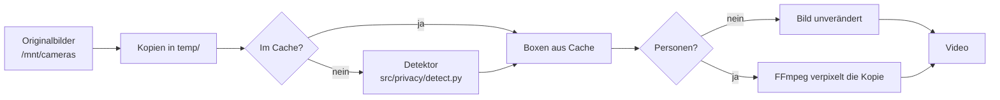

# Verpixelung von Personen und Kennzeichen

Erkennt Personen und Fahrzeuge in den Bildern eines Videos und macht Personen und Kennzeichen
vor dem Encoding unkenntlich. Der Code liegt in `src/privacy/`.

**Stand:** Testfunktion. Sie ist nur für historische Tagesvideos verfügbar (`--date` oder
`--jobs daily --target-date`). Automatische Läufe, Weekly, Monthly, Yearly und die
Weboberfläche verpixeln noch nicht.

Neue Kamerabilder direkt auf der Storage Box zu verpixeln, bevor die Webseite sie abholt,
beschreibt [verpixelung-box.md](verpixelung-box.md) (in Entwicklung).

Alle Pfade sind relativ zum Projektordner.

## Ablauf



1. Die Bilder werden wie bei jedem Lauf nach `temp/` kopiert. **Nur diese Kopien werden
   bearbeitet**, die Originale bleiben unverändert.
2. Bilder, die schon geprüft wurden, kommen aus dem Cache. Alle anderen gehen in Paketen zu
   50 Bildern an den Detektor, der als eigener Prozess läuft.
3. Erst wenn alle Pakete geprüft sind und der Detektor beendet ist, verpixelt FFmpeg jede Kopie
   mit Personen in einem Durchgang.
4. Danach wird das Video wie gewohnt erstellt.

## Installation

1. Python-Pakete: Der Detektor nutzt `onnxruntime`, `opencv-python-headless` und `numpy`. Sie
   stehen in `requirements.txt` und werden mit der normalen Installation eingerichtet:

   ```bash
   .venv/bin/python3 -m pip install -r requirements.txt
   ```

2. Modell: YOLOX aus dem [OpenCV Model Zoo](https://github.com/opencv/opencv_zoo/tree/main/models/object_detection_yolox)
   (Apache-2.0). Der Ordner `models/` ist per `.gitignore` vom Repository ausgeschlossen.

   ```bash
   mkdir -p models
   curl -L -o models/object_detection_yolox_2022nov.onnx \
   	https://github.com/opencv/opencv_zoo/raw/main/models/object_detection_yolox/object_detection_yolox_2022nov.onnx
   ```

   Die Datei ist ca. 36 MB groß. Die Lizenz des Modells liegt als `models/LICENSE-yolox` daneben.

3. Prüfen: Eine leere Anfrage muss die Detektor-Kennung liefern.

   ```bash
   echo -n | .venv/bin/python3 -I src/privacy/detect.py \
   	--model models/object_detection_yolox_2022nov.onnx
   ```

   Erwartete Ausgabe: `{"detector": "yolox_2022nov-…", "results": {}}`.

Fehlt das Modell, bricht ein Lauf mit `--blur-people` ab, bevor ein Bild bearbeitet wird.

## Aufruf

```bash
.venv/bin/python3 -m src.main --date 2026-06-28 --cameras SLSV --blur-people
```

- Erlaubt nur für historische Tagesvideos (`--date` oder `--jobs daily --target-date`).
  Jede andere Kombination wird abgelehnt.
- Das Video bekommt die Endung `_blur`, z. B.
  `videos/SLSV/manual-runs/daily/SLSV_2026-06-28_90min_blur.mp4`. So wird es nie mit einem
  unbearbeiteten Video verwechselt, und weder Aufräumen noch Weekly greifen darauf zu.
- Ein erneuter Lauf ersetzt das vorhandene `_blur`-Video.

## Konfiguration

Abschnitt `privacy` in `config/config.json`:

```json
"privacy": {
  "ignore_boxes": {"Scheunenviertel": [[703, 557, 742, 643]]},
  "ignore_top_share": 0.333,
  "detector_command": [
    ".venv/bin/python3", "-I", "src/privacy/detect.py",
    "--model", "models/object_detection_yolox_2022nov.onnx",
    "--tiles", "2",
    "--threshold", "0.25",
    "--vehicle-plate-share", "0.55",
    "--vehicle-threshold", "0.15",
    "--plate-search",
    "--vehicle-block-ratio", "0.0133"
  ],
  "blur": {
    "strength": 0.08,
    "padding_ratio": 0.05,
    "feather": 0.5
  }
}
```

### `detector_command`

Die Befehlszeile des Detektors als Liste, nie als Shell-Text. Steht hier `null`, bricht jeder
Lauf mit `--blur-people` ab.

| Option des Detektors | Bedeutung | Standard |
|---|---|---|
| `--model` | Pfad zur ONNX-Datei | Pflicht |
| `--tiles` | `1` = nur ganzes Bild, `2` = ganzes Bild plus vier überlappende Ausschnitte | `2` |
| `--threshold` | Mindestsicherheit einer Erkennung, 0–1 | `0.25` |
| `--nms` | Schwelle zum Zusammenfassen überlappender Boxen | `0.45` |
| `--threads` | Prozessor-Threads | `4` |
| `--vehicle-plate-share` | Anteil eines Fahrzeugs von unten, der verpixelt wird (Kennzeichen); `0` = nur Personen | `0` (Konfiguration: `0.55`) |
| `--vehicle-threshold` | Eigene Mindestsicherheit für Fahrzeuge, 0–1; niedriger als bei Personen, weil ein übersehenes Auto ein lesbares Kennzeichen hinterlässt, ein falsch erkanntes nur etwas Pflaster verpixelt | wie `--threshold` (Konfiguration: `0.15`) |
| `--plate-search` | Sucht in jedem Fahrzeug zusätzlich nach einem kennzeichenartigen Rechteck (hell, 3- bis 6-mal so breit wie hoch, mehrere dunkle Zeichen) und verpixelt es **zusätzlich** zum unteren Teil, nie stattdessen | aus (Konfiguration: an) |
| `--vehicle-block-ratio` | Blockgröße der Fahrzeug- und Kennzeichenbereiche als Anteil der Fahrzeugbreite, mindestens 4 px; `0` = Regel aus `blur.strength` | `0` (Konfiguration: `0.0133`) |

`--tiles 2` findet auch kleine Personen im Hintergrund, ist aber etwa fünfmal langsamer als
`--tiles 1`. Für den Datenschutz ist `2` die richtige Wahl.

### `ignore_boxes` und `ignore_top_share`

`ignore_boxes`: bekannte Fehlerkennungen pro Kamera als `[x0, y0, x1, y1]` in Pixeln. Eine Box,
die eine davon zu mindestens 50 % überlappt (Schnitt durch Vereinigung), wird verworfen.
Verschiebt sich die Kamera, sinkt die Überlappung und das Objekt wird wieder verpixelt. Beispiel:
der Wegweiser am Café-Eingang bei Scheunenviertel.

`ignore_top_share`: globale Regel für alle Kameras. Eine Box, die zu mehr als der Hälfte ihrer
Höhe im oberen Teil des Bildes liegt (hier oberes Drittel), wird verworfen. Dort sind Himmel, Dächer, Wasser oder die
Kamerahalterung, keine Person, die man erkennen könnte. Anlass: Bei Scheunenviertel hielt der
Detektor zweimal die Halterung oben rechts für eine Person, einmal mit einer 373 × 460 px großen
Box in der Dämmerung. Am 2026-08-16 betraf die Regel nur diese 2 von 1965 Boxen.

Die Regel greift beim Verpixeln, nicht im Detektor: Gespeicherte Erkennungen bleiben gültig,
eine Änderung des Werts braucht keine neue Erkennung. `0` schaltet die Regel ab.

Beide Regeln gelten im Video-Modus und im Box-Job gleich (eine gemeinsame Funktion,
`filter_boxes`). Verworfene Boxen stehen im Log (`Ignored box in …`) bzw. beim Box-Job in der
Statusdatei unter `ignored_boxes`. Beide Werte werden bei jedem Start geprüft: Ein Tippfehler wie
`ignore_top_share: 3.33` würde sonst stillschweigend jede Box verwerfen, deshalb bricht der Lauf
mit einer Fehlermeldung ab (erlaubt: 0 bis unter 0,5; Boxen mit vier ganzen Zahlen,
`x1 > x0`, `y1 > y0`). Kamerabezogene Regeln nur, wo sie nötig sind; eine Kamera mit Personen im oberen Drittel
(Hang, Balkon) bräuchte eine Ausnahme.

### Kennzeichenbereich (55 %, global)

Wie hoch das Kennzeichen im Kasten eines Autos sitzt, hängt vom Blickwinkel ab: Scheunenviertel
sieht viele Autos schräg von hinten oben, dort sitzt das Kennzeichen bei 41–53 % der Höhe
(gemessen 2026-10-16) und lag damit knapp über den früheren 40 %. Seitdem gilt
`--vehicle-plate-share 0.55` für alle Kameras: Auf anderen Kameras wird dadurch etwas mehr
verpixelt, die sichere Richtung. Eine kameraeigene Einstellung gibt es bewusst nicht mehr
(globale Regeln, solange keine Kamera eine eigene braucht).

Den Anteil nur nach oben erweitern, nie den Bereich nach oben verschieben: Frontkennzeichen und
Autos, die in einer Reihe hinter einem anderen stehen, haben ihr Kennzeichen ganz unten im
Kasten.

### Blockgröße für Kennzeichen (Entscheidung 2026-10-16)

Fahrzeuge werden feiner verpixelt als Personen, damit das Auto erkennbar bleibt. Der Detektor
schreibt die Blockgröße in jede Fahrzeug- und Kennzeichenbox (`block`), das Verpixeln übernimmt
sie; Personen behalten die Regel aus `blur.strength`. Die Blöcke wachsen mit der Breite des Autos
(`--vehicle-block-ratio 0.0133`, nie unter 4 px):

| Breite des Autos im Bild | Block | Beispiel Scheunenviertel |
|---|---|---|
| bis ca. 340 px | 4 px | fast alle Autos auf dem Platz |
| ca. 475 px | 6 px | vorderste Reihe |
| ca. 600 px | 8 px | sehr nah an der Kamera |

Warum mitwachsend statt fest 4 px: Je näher ein Auto, desto größer sein Kennzeichen im Bild. Ein
Kennzeichen von 75 px Breite hat bei 4 px etwa 2 Blöcke pro Zeichen und ist unlesbar; eines von
120 px Breite hätte bei festen 4 px 3–4 Blöcke pro Zeichen und könnte wieder lesbar werden. So
bekommt jedes Kennzeichen ungefähr gleich viele Blöcke. Eine Änderung von
`--vehicle-block-ratio` ändert die Detektor-Kennung und führt zu einer neuen Erkennung (beim
Tagesvideo ca. 11 Minuten statt 2).

Bei 4 px ist kein Zeichen mehr lesbar. Bekannt und bewusst in Kauf genommen: Bei sehr feiner
Verpixelung lässt sich ein Kennzeichen mit bekannter Schrift (FE-Schrift) unter Aufwand per
Computer zurückrechnen; 5–6 px würden das erschweren. Abgewogen gegen das Aussehen wurde 4 px
gewählt, weil ein solcher Angriff gezielten Aufwand braucht und ein Kennzeichen allein ohne
Halterauskunft niemanden identifiziert. Das größere Risiko sind Kennzeichen, die gar nicht
verpixelt werden.

### `blur`

Alle Werte sind Pflicht. Ein ungültiger Wert bricht den Lauf ab, bevor ein Bild bearbeitet
wird; der Konfigurationstest prüft die Werte zusätzlich.

| Wert | Bedeutung | Erlaubt |
|---|---|---|
| `strength` | Blockgröße als Anteil der kürzeren Seite des Bereichs (Personen; Fahrzeuge siehe Blockgröße oben) | 0,05–0,5 |
| `padding_ratio` | Rand, um den der Bereich je Seite über die erkannte Box hinaus wächst | 0,05–1,0 |
| `feather` | Anteil des Rands, der weich ausläuft (0 = harte Kante) | 0–1 |

- Jede Box bekommt mindestens 2 Pixel Rand, damit eine knapp erkannte Person nicht am Rand
  sichtbar bleibt.
- Weich ausgeblendet wird nur der zusätzliche Rand. **Die erkannte Box selbst ist immer
  vollständig unkenntlich.**
- Verpixelt wird immer ein Rechteck in Blöcken. Weichzeichnen (`blur`) und Ellipsen gab es
  früher; sie wurden nie genutzt und am 2026-10-16 entfernt.
- Neue `blur`-Werte lösen keine neue Erkennung aus: Ein erneuter Lauf nimmt die Boxen aus dem
  Cache und verpixelt nur neu.

## Sicherheitsregeln (fail closed)

Im Zweifel entsteht **kein** Video. Der Lauf bricht mit `PrivacyCheckError` ab, wenn:

- `detector_command` fehlt oder der Detektor nicht startet,
- der Detektor mit Fehler endet oder ein Paket länger als 900 Sekunden braucht,
- die Ausgabe kein gültiges JSON ist oder eine Detektor-Kennung fehlt,
- ein angefragtes Bild im Ergebnis fehlt oder eine Box ungültig ist,
- sich die Detektor-Kennung während des Laufs ändert,
- das Verpixeln eines Bildes fehlschlägt (FFmpeg-Fehler oder mehr als 120 Sekunden),
- eine Box vollständig außerhalb des Bildes liegt.

Ein ungeprüftes oder nicht verpixeltes Bild wird nie verwendet.

## Cache

Ergebnisse werden pro Kamera in `state/privacy/<Kamera>.jsonl` gespeichert, eine Zeile pro
Bild:

| Feld | Inhalt |
|---|---|
| `image` | Dateiname des Originals |
| `size`, `mtime_ns` | Größe und Änderungszeit, zur Erkennung geänderter Bilder |
| `detector` | Detektor-Kennung |
| `boxes` | erkannte Boxen: Koordinaten, Sicherheit, `label` (`person`, `vehicle`, `plate`; ältere Einträge ohne) und bei Fahrzeugen und Kennzeichen `block` |

Gespeichert werden nur Koordinaten, keine Bildausschnitte. Ein Bild wird neu geprüft, wenn es
sich geändert hat oder eine andere Detektor-Kennung gilt. Die Kennung enthält Modellname,
Prüfsumme des Modells, Laufzeit, Kachelung, Schwelle und die Fahrzeug-Einstellungen, z. B.
`yolox_2022nov-c5c2d13e-ort-t2-c0.25-u2-v0.55-vc0.15-ps-b0.0133` (`u2` = Zusammenfassen als
Vereinigung, bei Personen auch für Boxen, die fast ganz in einer anderen liegen; `v` =
Kennzeichenbereich, `vc` = Fahrzeug-Schwelle, `ps` = Kennzeichensuche, `b` = Blockgröße). Ein
anderes Modell oder eine andere Einstellung führt also automatisch zu einer neuen Prüfung.
`ignore_boxes` und `ignore_top_share` gehören nicht dazu, weil sie erst beim Verpixeln greifen.
Eine beschädigte Zeile gilt nur als fehlender Eintrag.

Jede neue Erkennung hängt eine Zeile an. Nach jedem Lauf, der etwas neu erkannt hat, wird die
Datei auf die neueste Zeile pro Bild verkleinert; das geschieht über eine temporäre Datei, die
erst zum Schluss die alte ersetzt, ein Stromausfall lässt den alten Cache also intakt.

Der Detektor liest die Bilder ohne EXIF-Drehung (`IMREAD_IGNORE_ORIENTATION`), also genau so,
wie FFmpeg sie verpixelt. Sonst lägen die Boxen bei einer Kamera mit Drehungs-Angabe daneben.

## Detektor-Protokoll

`src/privacy/detect.py` kann durch ein anderes Programm ersetzt werden, solange es dieses
Protokoll einhält:

- **Eingabe:** Bildpfade auf stdin, ein Pfad pro Zeile.
- **Ausgabe:** ein JSON-Objekt auf stdout:

  ```json
  {"detector": "<kennung>", "results": {"<pfad>": [{"x0": 0, "y0": 0, "x1": 10, "y1": 20, "score": 0.9, "label": "vehicle", "block": 4}]}}
  ```

- Jeder angefragte Pfad muss enthalten sein; eine leere Liste heißt „geprüft, nichts zu
  verpixeln".
- Jede Box ist ein zu verpixelnder Bereich. `label` (`person`, `vehicle` oder `plate`, optional)
  dient nur der Nachvollziehbarkeit: Es wird im Cache und in der Statusdatei des Box-Jobs
  gespeichert, ändert aber nicht, wie verpixelt wird.
- `block` (optional, mindestens 1) ist die Blockgröße in Pixeln für `pixelate`; fehlt es, gilt
  `blur.strength`.
- Personen und Fahrzeuge werden getrennt zusammengefasst (NMS), damit eine Person vor einem Auto
  nie in der Fahrzeugbox aufgeht.
- Eine leere Anfrage liefert nur die Kennung (`"results": {}`).
- Ein nicht lesbares Bild führt zu einem Exit-Code ungleich 0.

## Leistung

Gemessen auf dem Raspberry Pi 4 (2 GB):

| Schritt | Dauer |
|---|---|
| Erkennung | ca. 7,5–10 Sekunden pro Bild, unabhängig davon, ob Personen darauf sind |
| Verpixeln | ca. 1 Sekunde pro Bild mit Personen; Bilder ohne Personen kosten nichts |
| Tagesvideo, erster Lauf (ca. 70 Bilder) | ca. 12–13 Minuten |
| Tagesvideo, erneuter Lauf aus dem Cache | ca. 2 Minuten |

Arbeitsspeicher: Der Detektor braucht ca. 210 MB. Während eines Laufs waren bis zu 87 % des
Speichers belegt; Detektor und FFmpeg laufen nie gleichzeitig.

## Grenzen

- Keine Erkennung findet 100 % aller Personen. Sehr kleine, verdeckte oder unscharfe Personen
  können übersehen werden.
- Erkannt werden ganze Personen. Kennzeichen werden nicht einzeln erkannt: Der Detektor findet
  Fahrzeuge (Auto, Motorrad, Bus, Lkw) und meldet davon den unteren Teil
  (`--vehicle-plate-share`, 55 %), wo das Kennzeichen sitzt. Die
  Kennzeichensuche (`--plate-search`) findet nur gut sichtbare Kennzeichen (im Test etwa jedes
  fünfte Auto) und ergänzt deshalb nur. Ein Kennzeichen an anderer Stelle (z. B. am Dach eines
  Wohnmobils) wird nur erfasst, wenn die Suche es findet.
- Ein Auto, das in einem Bild nicht erkannt wird, wird in diesem Bild nicht verpixelt. Die
  niedrigere Schwelle für Fahrzeuge (`--vehicle-threshold`) verringert das, schließt es aber nicht
  aus.
- Ein Weekly setzt sich aus den unbearbeiteten Tagesvideos zusammen und enthält deshalb keine
  verpixelten Personen.

## Fehlersuche

| Meldung im Log | Ursache | Lösung |
|---|---|---|
| `Blurring was requested but privacy.detector_command is not set.` | `detector_command` ist `null` | Befehl in `config.json` eintragen |
| `Detector could not be started: …` | Python oder Skript nicht gefunden | Lauf aus dem Projektordner starten, `.venv` prüfen |
| `Detector failed with exit code …` | Modell fehlt, Paket fehlt oder Bild nicht lesbar | Installation prüfen (siehe oben), Meldung des Detektors im Log lesen |
| `Detector timed out after 900 s …` | Rechner überlastet | andere Läufe abwarten, Arbeitsspeicher prüfen |
| `privacy.blur.<Wert> must be …` | ungültiger Wert in `blur` | Wert laut Tabelle korrigieren |
| `Detector id changed during the run` | Modell während des Laufs ausgetauscht | Lauf erneut starten |
| `No blurrable region left for …` | Detektor meldet eine Box außerhalb des Bildes | Detektor bzw. Modell prüfen |
| `Detector box for … has an invalid 'block'` bzw. `'label'` | Detektor liefert eine Blockgröße unter 1 oder ein Label, das kein Text ist | Detektor prüfen; mit dem mitgelieferten `detect.py` tritt das nicht auf |
| `Ignored box in …` (kein Fehler) | Box passte zu `ignore_boxes` oder lag überwiegend im oberen Drittel (`ignore_top_share`) | Nur prüfen, wenn dort doch eine echte Person war; dann die Regel anpassen |
| `privacy.ignore_top_share must be …` bzw. `privacy.ignore_boxes … invalid box` | Tippfehler in der Regel; sie hätte zu viel verworfen | Wert korrigieren (0 bis unter 0,5; Boxen `[x0, y0, x1, y1]` als ganze Zahlen) |
| `Cannot read the size of …` | FFprobe liefert keine oder eine unerwartete Bildgröße (Bild beschädigt) | Bild prüfen; im Box-Job betrifft das nur dieses Bild, es wird jede Runde erneut versucht |

Ohne Logmeldung, beim Ansehen des Videos:

| Beobachtung | Ursache | Lösung |
|---|---|---|
| Kennzeichen knapp über dem verpixelten Bereich | Blickwinkel der Kamera: Kennzeichen sitzt höher im Fahrzeugkasten | `--vehicle-plate-share` erhöhen (heute `0.55`), nie den Bereich verschieben; Bildnummer notieren |
| Auto in einem Bild verpixelt, im nächsten nicht | Erkennungssicherheit schwankt von Bild zu Bild | `--vehicle-threshold` prüfen (`0.15`); Bildnummer notieren, Cache-Eintrag ansehen |
| Nur ein halbes Auto bzw. eine halbe Person verpixelt | früher: Kachelgrenze bei x = 768 (seit 2026-10-16 behoben, Kennung `-u2`) | Video mit aktuellem Detektor neu erzeugen |
| Große Pixelfläche oben im Bild ohne Person | Fehlerkennung, z. B. Kamerahalterung | liegt sie überwiegend im oberen Drittel, verwirft `ignore_top_share` sie; sonst als `ignore_boxes` eintragen |
| Auto zu grob verpixelt | `--vehicle-block-ratio` fehlt oder ist `0` | Wert `0.0133` setzen |
