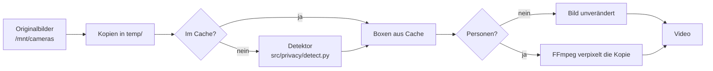

# Verpixelung von Personen

Erkennt Personen in den Bildern eines Videos und macht sie vor dem Encoding unkenntlich. Der
Code liegt in `src/privacy/`.

**Stand:** Testfunktion. Sie ist nur für historische Tagesvideos verfügbar (`--date` oder
`--jobs daily --target-date`). Automatische Läufe, Weekly, Monthly, Yearly und die
Weboberfläche verpixeln noch nicht.

Alle Pfade sind relativ zum Projektordner.

## Ablauf



1. Die Bilder werden wie bei jedem Lauf nach `temp/` kopiert. **Nur diese Kopien werden
   bearbeitet**, die Originale bleiben unverändert.
2. Bilder, die schon geprüft wurden, kommen aus dem Cache. Alle anderen gehen in Paketen zu
   50 Bildern an den Detektor, der als eigener Prozess läuft.
3. Erst wenn alle Pakete geprüft sind und der Detektor beendet ist, verpixelt FFmpeg jede Kopie
   mit Personen in einem Durchgang.
4. Danach wird das Video wie gewohnt erstellt.

## Installation

1. Python-Pakete: Der Detektor nutzt `onnxruntime`, `opencv-python-headless` und `numpy`. Sie
   stehen in `requirements.txt` und werden mit der normalen Installation eingerichtet:

   ```bash
   .venv/bin/python3 -m pip install -r requirements.txt
   ```

2. Modell: YOLOX aus dem [OpenCV Model Zoo](https://github.com/opencv/opencv_zoo/tree/main/models/object_detection_yolox)
   (Apache-2.0). Der Ordner `models/` ist per `.gitignore` vom Repository ausgeschlossen.

   ```bash
   mkdir -p models
   curl -L -o models/object_detection_yolox_2022nov.onnx \
   	https://github.com/opencv/opencv_zoo/raw/main/models/object_detection_yolox/object_detection_yolox_2022nov.onnx
   ```

   Die Datei ist ca. 36 MB groß. Die Lizenz des Modells liegt als `models/LICENSE-yolox` daneben.

3. Prüfen: Eine leere Anfrage muss die Detektor-Kennung liefern.

   ```bash
   echo -n | .venv/bin/python3 -I src/privacy/detect.py \
   	--model models/object_detection_yolox_2022nov.onnx
   ```

   Erwartete Ausgabe: `{"detector": "yolox_2022nov-…", "results": {}}`.

Fehlt das Modell, bricht ein Lauf mit `--blur-people` ab, bevor ein Bild bearbeitet wird.

## Aufruf

```bash
.venv/bin/python3 -m src.main --date 2026-06-28 --cameras SLSV --blur-people
```

- Erlaubt nur für historische Tagesvideos (`--date` oder `--jobs daily --target-date`).
  Jede andere Kombination wird abgelehnt.
- Das Video bekommt die Endung `_blur`, z. B.
  `videos/SLSV/manual-runs/daily/SLSV_2026-06-28_90min_blur.mp4`. So wird es nie mit einem
  unbearbeiteten Video verwechselt, und weder Aufräumen noch Weekly greifen darauf zu.
- Ein erneuter Lauf ersetzt das vorhandene `_blur`-Video.

## Konfiguration

Abschnitt `privacy` in `config/config.json`:

```json
"privacy": {
  "detector_command": [
    ".venv/bin/python3", "-I", "src/privacy/detect.py",
    "--runtime", "ort",
    "--model", "models/object_detection_yolox_2022nov.onnx",
    "--tiles", "2",
    "--threshold", "0.25"
  ],
  "blur": {
    "style": "pixelate",
    "strength": 0.1,
    "padding_ratio": 0.25,
    "shape": "ellipse",
    "feather": 0.5
  }
}
```

### `detector_command`

Die Befehlszeile des Detektors als Liste, nie als Shell-Text. Steht hier `null`, bricht jeder
Lauf mit `--blur-people` ab.

| Option des Detektors | Bedeutung | Standard |
|---|---|---|
| `--model` | Pfad zur ONNX-Datei | Pflicht |
| `--runtime` | `ort` (onnxruntime) oder `cv2` (OpenCV DNN) | `ort` |
| `--tiles` | `1` = nur ganzes Bild, `2` = ganzes Bild plus vier überlappende Ausschnitte | `2` |
| `--threshold` | Mindestsicherheit einer Erkennung, 0–1 | `0.25` |
| `--nms` | Schwelle zum Zusammenfassen überlappender Boxen | `0.45` |
| `--threads` | Prozessor-Threads | `4` |

`--tiles 2` findet auch kleine Personen im Hintergrund, ist aber etwa fünfmal langsamer als
`--tiles 1`. Für den Datenschutz ist `2` die richtige Wahl.

### `blur`

Alle Werte sind Pflicht. Ein ungültiger Wert bricht den Lauf ab, bevor ein Bild bearbeitet
wird; der Konfigurationstest prüft die Werte zusätzlich.

| Wert | Bedeutung | Erlaubt |
|---|---|---|
| `style` | `blur` verwischt, `pixelate` vergröbert in Blöcke | `blur`, `pixelate` |
| `strength` | Unschärferadius bzw. Blockgröße als Anteil der kürzeren Seite des Bereichs | 0,05–0,5 |
| `padding_ratio` | Rand, um den der Bereich je Seite über die erkannte Box hinaus wächst | 0,1–1,0 |
| `shape` | Rechteck oder Ellipse um die Box | `rectangle`, `ellipse` |
| `feather` | Anteil des Rands, der weich ausläuft (0 = harte Kante) | 0–1 |

- Jede Box bekommt mindestens 8 Pixel Rand, damit eine knapp erkannte Person nicht am Rand
  sichtbar bleibt.
- Weich ausgeblendet wird nur der zusätzliche Rand. **Die erkannte Box selbst ist immer
  vollständig unkenntlich.**
- Eine Ellipse umschließt die Ecken der Box vollständig.
- Neue `blur`-Werte lösen keine neue Erkennung aus: Ein erneuter Lauf nimmt die Boxen aus dem
  Cache und verpixelt nur neu.

## Sicherheitsregeln (fail closed)

Im Zweifel entsteht **kein** Video. Der Lauf bricht mit `PrivacyCheckError` ab, wenn:

- `detector_command` fehlt oder der Detektor nicht startet,
- der Detektor mit Fehler endet oder ein Paket länger als 900 Sekunden braucht,
- die Ausgabe kein gültiges JSON ist oder eine Detektor-Kennung fehlt,
- ein angefragtes Bild im Ergebnis fehlt oder eine Box ungültig ist,
- sich die Detektor-Kennung während des Laufs ändert,
- das Verpixeln eines Bildes fehlschlägt (FFmpeg-Fehler oder mehr als 120 Sekunden),
- eine Box vollständig außerhalb des Bildes liegt.

Ein ungeprüftes oder nicht verpixeltes Bild wird nie verwendet.

## Cache

Ergebnisse werden pro Kamera in `state/privacy/<Kamera>.jsonl` gespeichert, eine Zeile pro
Bild:

| Feld | Inhalt |
|---|---|
| `image` | Dateiname des Originals |
| `size`, `mtime_ns` | Größe und Änderungszeit, zur Erkennung geänderter Bilder |
| `detector` | Detektor-Kennung |
| `boxes` | erkannte Boxen (Koordinaten und Sicherheit) |

Gespeichert werden nur Koordinaten, keine Bildausschnitte. Ein Bild wird neu geprüft, wenn es
sich geändert hat oder eine andere Detektor-Kennung gilt. Die Kennung enthält Modellname,
Prüfsumme des Modells, Laufzeit, Kachelung und Schwelle, z. B.
`yolox_2022nov-c5c2d13e-ort-t2-c0.25`. Ein anderes Modell oder eine andere Einstellung führt
also automatisch zu einer neuen Prüfung. Eine beschädigte Zeile gilt nur als fehlender Eintrag.

## Detektor-Protokoll

`src/privacy/detect.py` kann durch ein anderes Programm ersetzt werden, solange es dieses
Protokoll einhält:

- **Eingabe:** Bildpfade auf stdin, ein Pfad pro Zeile.
- **Ausgabe:** ein JSON-Objekt auf stdout:

  ```json
  {"detector": "<kennung>", "results": {"<pfad>": [{"x0": 0, "y0": 0, "x1": 10, "y1": 20, "score": 0.9}]}}
  ```

- Jeder angefragte Pfad muss enthalten sein; eine leere Liste heißt „geprüft, keine Person".
- Eine leere Anfrage liefert nur die Kennung (`"results": {}`).
- Ein nicht lesbares Bild führt zu einem Exit-Code ungleich 0.

## Leistung

Gemessen auf dem Raspberry Pi 4 (2 GB):

| Schritt | Dauer |
|---|---|
| Erkennung | ca. 7,5–10 Sekunden pro Bild, unabhängig davon, ob Personen darauf sind |
| Verpixeln | ca. 1 Sekunde pro Bild mit Personen; Bilder ohne Personen kosten nichts |
| Tagesvideo, erster Lauf (ca. 70 Bilder) | ca. 12–13 Minuten |
| Tagesvideo, erneuter Lauf aus dem Cache | ca. 2 Minuten |

Arbeitsspeicher: Der Detektor braucht ca. 210 MB. Während eines Laufs waren bis zu 87 % des
Speichers belegt; Detektor und FFmpeg laufen nie gleichzeitig.

## Grenzen

- Keine Erkennung findet 100 % aller Personen. Sehr kleine, verdeckte oder unscharfe Personen
  können übersehen werden.
- Erkannt werden ganze Personen, keine Gesichter oder Kennzeichen.
- Ein Weekly setzt sich aus den unbearbeiteten Tagesvideos zusammen und enthält deshalb keine
  verpixelten Personen.

## Fehlersuche

| Meldung im Log | Ursache | Lösung |
|---|---|---|
| `Blurring was requested but privacy.detector_command is not set.` | `detector_command` ist `null` | Befehl in `config.json` eintragen |
| `Detector could not be started: …` | Python oder Skript nicht gefunden | Lauf aus dem Projektordner starten, `.venv` prüfen |
| `Detector failed with exit code …` | Modell fehlt, Paket fehlt oder Bild nicht lesbar | Installation prüfen (siehe oben), Meldung des Detektors im Log lesen |
| `Detector timed out after 900 s …` | Rechner überlastet | andere Läufe abwarten, Arbeitsspeicher prüfen |
| `privacy.blur.<Wert> must be …` | ungültiger Wert in `blur` | Wert laut Tabelle korrigieren |
| `Detector id changed during the run` | Modell während des Laufs ausgetauscht | Lauf erneut starten |
| `No blurrable region left for …` | Detektor meldet eine Box außerhalb des Bildes | Detektor bzw. Modell prüfen |
